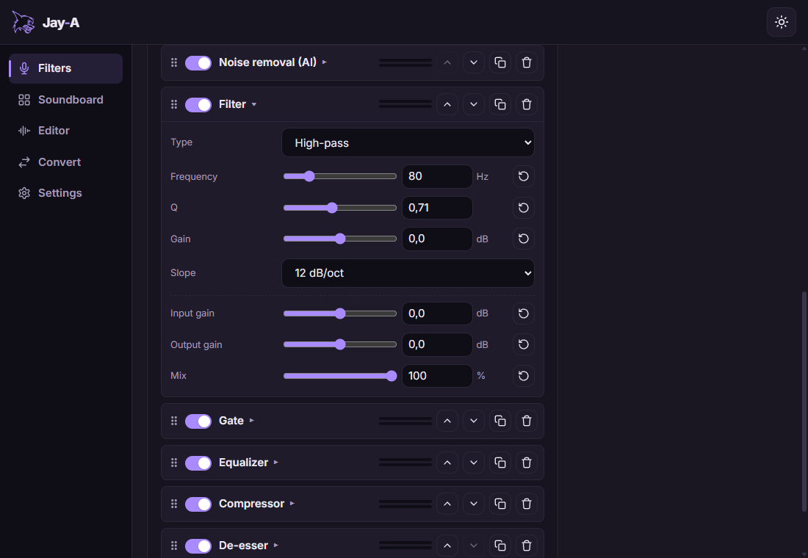
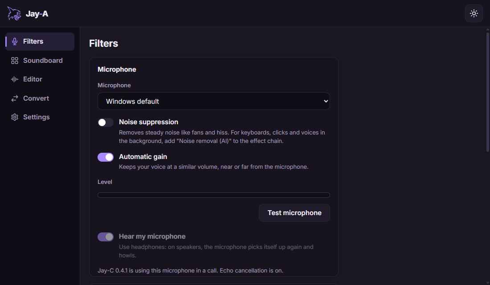
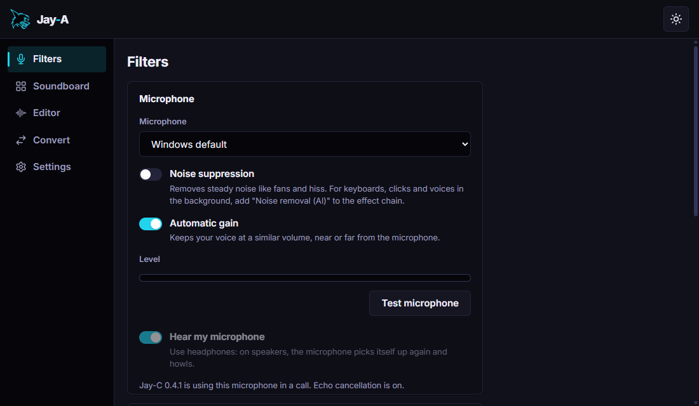
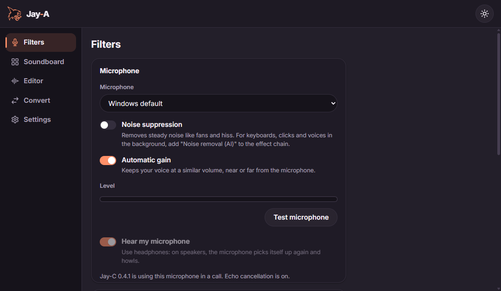

# Jay-A

**English** · [Português](README.pt-BR.md)

The audio app of the Jay line: filters for your microphone, which [Jay-C](https://github.com/TyxMatty/Jay-C) can use in its calls instead of its own, and later audio editing, a soundboard and format conversion. Windows first.

<p align="center"></p>

- **Clean voice in calls:** AI noise removal (DeepFilterNet or RNNoise) takes out keyboards, clicks and fans; WebRTC's cleanup and echo cancellation come first.
- **Your own effect chain:** filter, gate, equalizer, compressor, de-esser and limiter, in the order you choose, with live meters and presets you can save, import and export.
- **Linked to Jay-C:** Jay-C gets the filtered microphone over a local pipe. If Jay-A stops, Jay-C's own filter takes over at once and the call goes on.
- **Light:** it lives in the tray and only opens the microphone while someone uses it.

<table>
  <tr>
    <td></td>
    <td></td>
    <td></td>
  </tr>
  <tr align="center"><td>Calm</td><td>Neon</td><td>Soft</td></tr>
</table>

## Download

Install and update Jay-A from **[Jay-H](https://github.com/TyxMatty/Jay-H)**, the Jay line's hub. Or download `Jay-A_<version>_x64-setup.exe` from the **[latest release](https://github.com/TyxMatty/Jay-A/releases/latest)**: it updates an earlier version in place and keeps your settings. Every version is listed under [releases](https://github.com/TyxMatty/Jay-A/releases).

## Code

| Folder | Contents |
|---|---|
| [`crates/jay-audio/`](crates/jay-audio/) | The audio engine (Rust, no Tauri): microphone, WebRTC's audio processing, the effect chain and its effects, the Jay Link server |
| [`frontend/`](frontend/) | Tauri v2 + vanilla JS app (Vite) |
| [`docs/ARQUITETURA.md`](docs/ARQUITETURA.md) | Architecture, flows, stages and what was measured (in Portuguese) |
| [`docs/REFERENCIAS.md`](docs/REFERENCIAS.md) | Notes from studying EasyEffects and Carla (ideas only, no code) |
| [`scripts/`](scripts/) | Development tools: the app with debugging on, running JS in the real app, synthetic speech for tests, the README's screenshots |

## Running the app

```bash
npm install
npm run dev
```

This opens the Jay-A window (Tauri) with hot reload. Closing the window keeps Jay-A in the tray; to quit, right-click its icon there. `jay-a.exe --background` starts it in the tray only (that's how Jay-C starts it). To open only the interface in a browser, without Tauri, use `npm run web` (port 5175).

The build also needs **Python with Meson and Ninja** (`py -m pip install --user meson ninja`, with Python's Scripts folder on the PATH), for WebRTC's audio processing. The first build downloads abseil-cpp and takes a few minutes more.

The Rust build takes several GB. To keep it out of OneDrive, create a `.cargo/config.toml` (not tracked by git) pointing elsewhere:

```toml
[build]
target-dir = "C:/Users/<you>/.cargo-target/jay-a"
```

## Releases

A version tag (`v*`) builds the installer in GitHub Actions ([`installer.yml`](.github/workflows/installer.yml)); publishing it in a release with the same tag delivers the update through Jay-H.

## Tests

```bash
npm test
cd crates/jay-audio && cargo test
```
