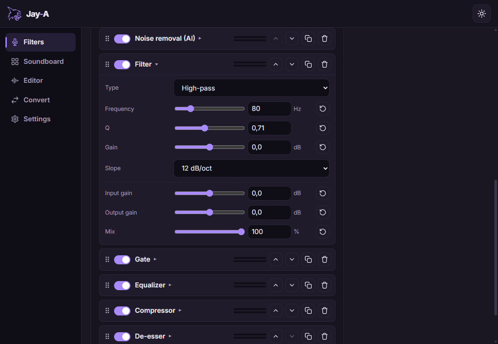
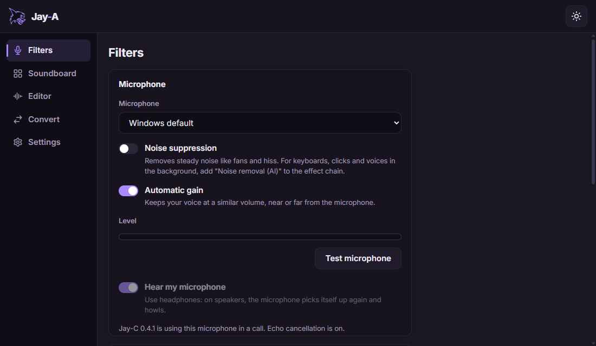
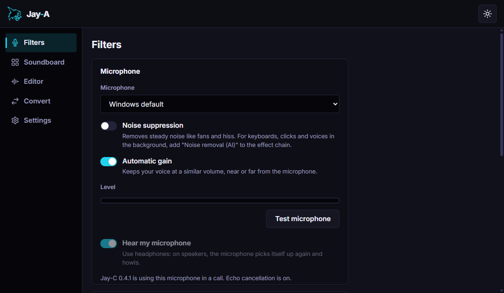
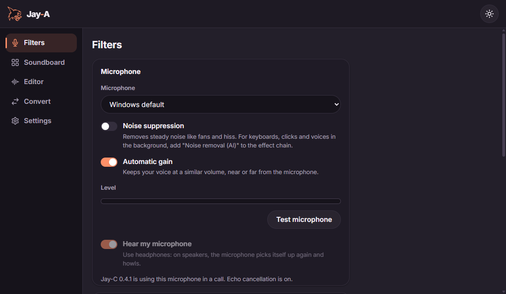

# Jay-A

[English](README.md) · **Português**

O app de áudio da linha Jay: filtros para o seu microfone, que o [Jay-C](https://github.com/TyxMatty/Jay-C) pode usar nas chamadas no lugar dos dele, e, mais adiante, edição de áudio, soundboard e conversão de formatos. Windows primeiro.

<p align="center"></p>

- **Voz limpa nas chamadas:** a remoção de ruído por IA (DeepFilterNet ou RNNoise) tira teclado, cliques e ventilador; a limpeza e o cancelamento de eco do WebRTC vêm antes.
- **A sua cadeia de efeitos:** filtro, gate, equalizador, compressor, de-esser e limitador, na ordem que você escolher, com medidores ao vivo e presets para salvar, importar e exportar.
- **Ligado ao Jay-C:** o Jay-C recebe o microfone filtrado por um pipe local. Se o Jay-A parar, o filtro do próprio Jay-C assume na hora e a chamada continua.
- **Leve:** fica na bandeja e só abre o microfone enquanto alguém o usa.

<table>
  <tr>
    <td></td>
    <td></td>
    <td></td>
  </tr>
  <tr align="center"><td>Calmo</td><td>Neon</td><td>Suave</td></tr>
</table>

## Requisitos

- **Windows 10 (1803 ou mais novo) ou 11.**
- **[VB-CABLE](https://vb-audio.com/Cable/)** (VB-Audio, donationware grátis), para usar o Jay-A como microfone em **outros apps** (Discord, OBS...) e mandar o soundboard para eles. O Jay-A o instala para você: **Filtros › Configurar o cabo virtual…** baixa o instalador da própria VB-Audio, confere a assinatura e o abre (o Windows pede permissão de administrador, porque é um driver de som), e depois liga a ponte. O VB-CABLE não vai dentro do instalador do Jay-A: isso exige uma licença de distribuidor da VB-Audio.
- **O Jay-C não precisa do cabo:** ele recebe o microfone e o soundboard do Jay-A direto.

## Download

Instale e atualize o Jay-A pelo **[Jay-H](https://github.com/TyxMatty/Jay-H)**, o hub da linha Jay. Ou baixe o `Jay-A_<versão>_x64-setup.exe` do **[último release](https://github.com/TyxMatty/Jay-A/releases/latest)**: ele atualiza uma versão anterior no lugar e mantém as suas configurações. Todas as versões estão em [releases](https://github.com/TyxMatty/Jay-A/releases).

## Código

| Pasta | Conteúdo |
|---|---|
| [`crates/jay-audio/`](crates/jay-audio/) | O engine de áudio (Rust, sem Tauri): microfone, processamento de áudio do WebRTC, a cadeia e os efeitos, o servidor do Jay Link |
| [`frontend/`](frontend/) | App Tauri v2 + JS puro (Vite) |
| [`docs/ARQUITETURA.md`](docs/ARQUITETURA.md) | Arquitetura, fluxos, etapas e o que foi medido |
| [`docs/REFERENCIAS.md`](docs/REFERENCIAS.md) | Notas do estudo do EasyEffects e do Carla (só ideias, nenhum código) |
| [`scripts/`](scripts/) | Ferramentas de desenvolvimento: o app com depuração, rodar JS no app de verdade, fala sintética para testes, os prints do README |

## Rodando o app

```bash
npm install
npm run dev
```

Isso abre a janela do Jay-A (Tauri) com recarregamento automático. Fechar a janela deixa o Jay-A na bandeja; para sair, clique com o botão direito no ícone dele. `jay-a.exe --background` abre só na bandeja (é assim que o Jay-C o inicia). Para abrir só a interface no navegador, sem Tauri, use `npm run web` (porta 5175).

O build também precisa de **Python com Meson e Ninja** (`py -m pip install --user meson ninja`, com a pasta Scripts do Python no PATH), para o processamento de áudio do WebRTC. O primeiro build baixa o abseil-cpp e leva alguns minutos a mais.

O build do Rust gera vários GB. Para não ir para o OneDrive, crie um `.cargo/config.toml` (fica fora do git) apontando para outra pasta:

```toml
[build]
target-dir = "C:/Users/<você>/.cargo-target/jay-a"
```

## Releases

Um tag de versão (`v*`) gera o instalador no GitHub Actions ([`installer.yml`](.github/workflows/installer.yml)); publicá-lo num release com o mesmo tag entrega a atualização pelo Jay-H.

## Testes

```bash
npm test
cd crates/jay-audio && cargo test
```
