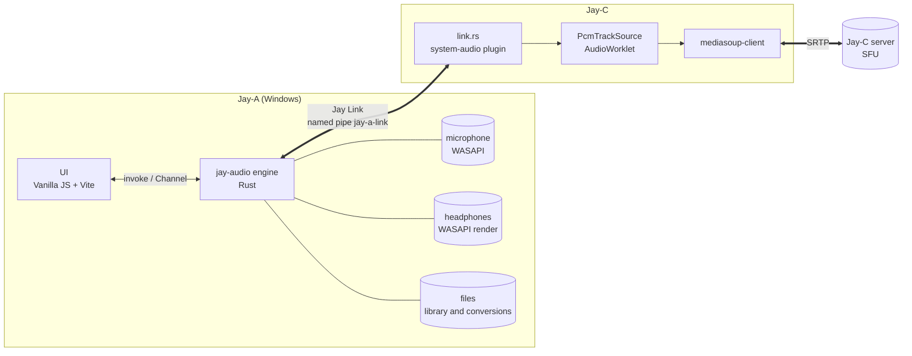
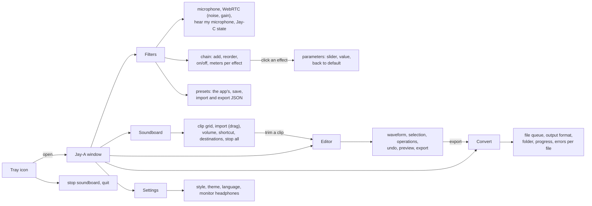
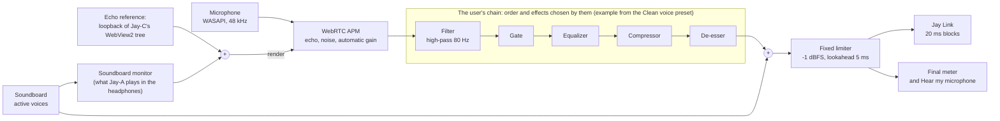
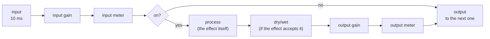
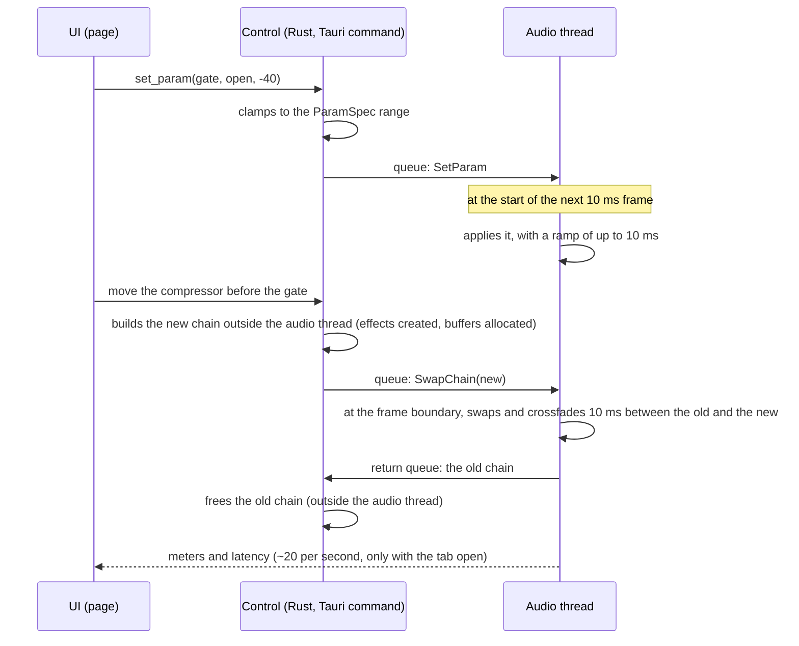
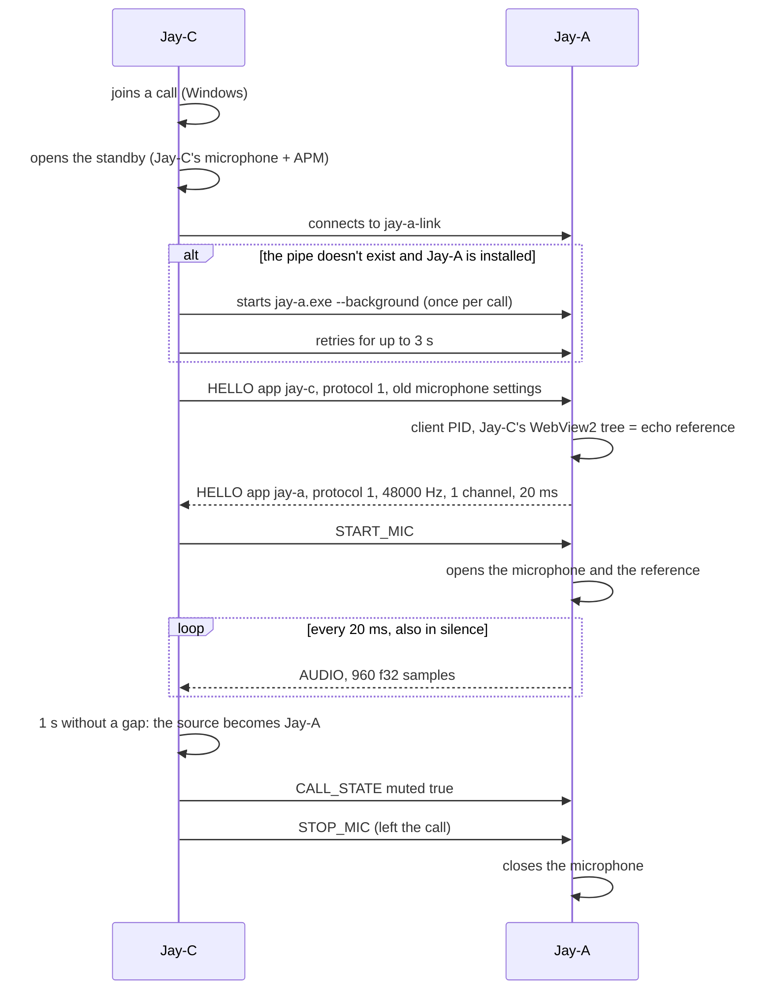
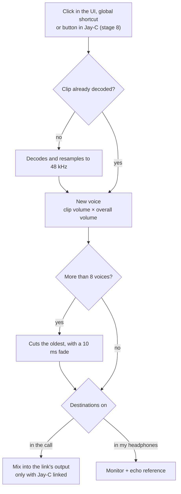
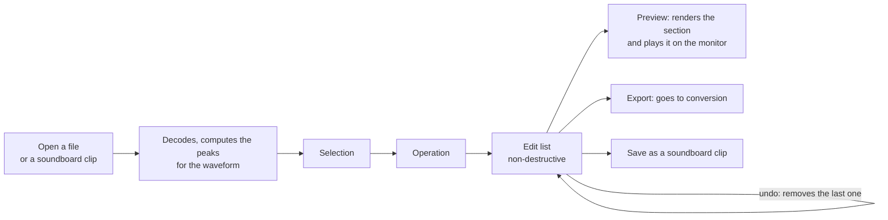
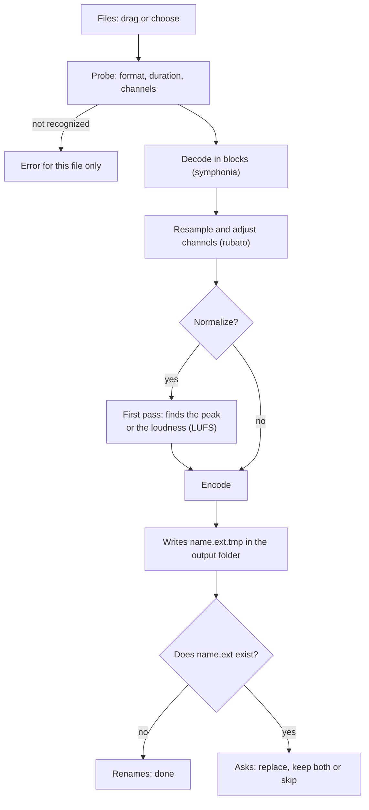

# Jay-A — Architecture

[Português](ARQUITETURA.md) · **English**

> Translation of [ARQUITETURA.md](ARQUITETURA.md). The Portuguese file is the reference and is updated first, so this one may lag behind it.

The audio app of the Jay line: **microphone filters** (an option in Jay-C, in place of its own filter, like Krisp in Discord), **audio editing**, a **soundboard** and **format conversion**. Windows first, like Jay-C's native audio.

Written on 2026-11-06, from Jay-C 0.4.0 (`b30199a`). Jay-C's side of the integration is in `docs/JAY-A.md` in the JayC repository. Stages 0 and 1 are done; what depends on measurement is marked as a spike. The study of EasyEffects and Carla, which the effect chain (section 5) is based on, is in [`REFERENCIAS.en.md`](REFERENCIAS.en.md). License: **MIT** (D6).

## 1. Overview



- In Jay-C, the user picks the **microphone filter**: Jay-A or Jay-C. With Jay-A, it captures, filters, mixes in the soundboard and hands the finished audio to Jay-C through the **Jay Link**, a local named pipe.
- **Jay-C** passes that audio on to WebRTC through the same `PcmTrackSource` as today. Meanwhile, it keeps its own microphone and APM running as a **hot standby**: if Jay-A crashes or hangs, the next block already comes from the standby, without switching the track (`JAY-A.md`, section 3). The server and signaling don't change.
- Jay-C's filter **stays forever**, as an option and as the standby (D1 = b).
- Jay-A runs in the **tray**: closing the window doesn't stop the filters. The microphone is only open while Jay-C asks for it (or during a test in the UI), so Windows' microphone indicator isn't lit for nothing.

| Function | Jay-C filter (today, stays) | Jay-A filter |
|---|---|---|
| Microphone capture (WASAPI, shared mode) | `system-audio/src/win.rs` | Jay-A; Jay-C's standby opens the same microphone at the same time |
| Echo, noise, automatic gain (WebRTC APM) | `system-audio/src/apm.rs` | Jay-A |
| Volume and sensitivity (gate) | `core/mic-shape.js` | Jay-A (ported to Rust); in Jay-C, only in the standby |
| Microphone choice | Jay-C's Settings › Audio | Jay-A; the standby follows it (`deviceId`) |
| The call's speakers, mute, deafen | Jay-C | Jay-C (no change) |
| Microphone on Android | `getUserMedia` | no change (Jay-A is Windows only) |

### Functional requirements

| # | Requirement | Stage |
|---|---|---|
| RF-F1 | Pick the microphone (Windows' list or the default) and test it with a meter | 1 ✅ |
| RF-F2 | Turn WebRTC processing on and off: noise suppression and automatic gain (echo cancellation turns on with the Jay Link) | 1 ✅ / 3 |
| RF-F3 | Build the **effect chain**: add, remove, duplicate and **reorder** effects, and turn each one on or off without taking it out of the chain | 2 |
| RF-F4 | Adjust each parameter within its range (slider, typed value and "back to default"), taking effect on the next frame and without a click | 2 |
| RF-F5 | See the level at the input and output of each effect, the final level and the chain's total latency | 2 |
| RF-F6 | Presets: the ones that come with the app, save the current one, import and export as JSON | 2 |
| RF-F7 | "Hear my microphone": the chain's output in the headphones | 1 ✅ |
| RF-F8 | AI noise removal (DeepFilterNet, RNNoise) for keyboard, clicks and voices in the background | 2d |
| RF-F9 | Voice effects (pitch, robot, reverb) | 7 |
| RF-L1 | Serve the Jay Link to Jay-C: `HELLO`, microphone on request, `AUDIO` every 20 ms, state with `deviceId` | 3 |
| RF-L2 | Open in the tray only with `--background`; single instance | 0 ✅ |
| RF-S1 | Soundboard: import clips, play by click or global shortcut, choose the destinations (call, headphones), volume per clip and stop all | 4 |
| RF-E1 | Editor: cut, fade, gain, normalize (peak or LUFS), reverse, speed, apply a filter preset; undo, preview, export | 6 |
| RF-C1 | Batch conversion between WAV, FLAC, MP3, OGG and Opus (also opens M4A/AAC, AIFF, ALAC), with cancel and without overwriting without asking | 5 |
| RF-A1 | Jay-C's three styles and themes, English and Portuguese, tray with Open and Quit | 0 ✅ |

### Non-functional requirements

| # | Requirement | How to measure |
|---|---|---|
| RNF-1 Latency | The stage 2 chain adds at most **5 ms** (the limiter's lookahead; IIR filters, gate and compressor add no delay). With AI noise removal (DeepFilterNet), **45 ms** (40 from it + 5 from the limiter); with RNNoise, 15 ms. The link adds at most 5 ms at p99 over Jay-C's native microphone | the latency each effect reports; correlation with Jay-C's standby (S1) |
| RNF-2 Continuity | With the microphone on, one `AUDIO` block every 20 ms, also in silence; **no gap above 60 ms** | Jay-C's `jay_a_probe` for 30 s |
| RNF-3 Real time | The audio thread **never waits**: it takes no blocking lock, allocates no memory, reads no disk or pipe. Changes arrive through a queue and go in between frames (section 5) | code review; a test that changes parameters 1,000 times per second without a gap |
| RNF-4 No clicks | Changing a parameter, turning an effect on/off, reordering and switching presets ramp over at most 10 ms; no step in the output | sine test: the largest difference between neighboring samples doesn't grow during the change |
| RNF-5 CPU | The stage 2 chain, with every effect on, uses less than **2% of one core** at 48 kHz mono (Ryzen 5 5600G, the machine behind Jay-C's numbers) | performance test with 60 s of audio |
| RNF-6 Robustness | A disconnected microphone, a corrupted file or a refused shortcut become a warning on screen; nothing brings the app or the call down | each stage's tests |
| RNF-7 Privacy | The microphone only opens when Jay-C asks or in a test on screen; closing the window ends the test. No audio leaves the computer through Jay-A | Windows' microphone indicator |
| RNF-8 Security | The pipe only accepts the current user and nothing from the network (section 6); audio files are untrusted input, with size and duration limits; Rust decoders wherever possible | review; corrupted files in the conversion tests |
| RNF-9 Platform | Windows 10 2004 or newer, x64, WebView2 | — |
| RNF-10 License | Jay-A is **MIT**. Permissive dependencies (MIT, BSD, Apache, per-file MPL); LGPL only if the user can swap the library (which is the case in an open-source app). GPL code, like EasyEffects' and Carla's, doesn't go in | `cargo tree` and `package-lock.json` reviewed with each new dependency |
| RNF-11 Accessibility and language | Everything works from the keyboard, with labels for screen readers; the contrast of Jay-C's styles; all text in English and in Portuguese | `npm test` (the translations test) |
| RNF-12 Size | Installer of up to 20 MB, counting the noise suppression models (Jay-C's is 1.5 MB). Since 0.3.4, the published file is the Jay-I setup, which carries the NSIS inside (the workflow fails above 20 MB) | the installer `.exe` |

## 2. Technical decisions

| Topic | Choice | Reason |
|---|---|---|
| Shell and UI | **Tauri v2 + Vanilla JS + Vite**, like Jay-C | Same stack, same lightness. Copies from Jay-C `styles/theme.css`, the Calm/Neon/Soft styles, `ui/dom.js` (`h()`), `core/i18n.js` and `ui/icons.js`. |
| Icons | **Jay-C's** (`src-tauri/icons/`, `app-icon.png`), copied | The user's request. Changing them later is one `npx tauri icon <png>`. |
| Engine | Rust crate **`jay-audio`**, with no Tauri dependency | Tests with `cargo test` without building the app (like Jay-C's `system-audio` plugin). The Tauri commands live in `src-tauri`. |
| Integration with Jay-C | **Named pipe** `\\.\pipe\jay-a-link`, frames of opcode (u32 LE) + length (u32 LE) + data | It's the format Jay-C's `discord.rs` already speaks, with no new dependency. No TCP port: no firewall, and Windows reports the PID of whoever connected. |
| Base filters | **WebRTC AudioProcessing**, copied from Jay-C (`third_party/`, `jayc_apm.cpp`, `apm.rs`), which keeps its own | Already measured (33 dB of echo removed) and the same as Chromium's and Discord's. |
| Own filters | Biquad (filters and EQ), gate, compressor, de-esser and limiter **written by hand** in Rust | Each one is 30–80 lines (RBJ recipes for the biquads). Not worth a dependency, and EasyEffects' GPL code can't go in. |
| Effect chain | **Rack**: an ordered list of instances (`gate#0`, `eq#1`) that the user builds, like EasyEffects and Carla's rack mode | The right order depends on the voice and the microphone; a fixed order doesn't suit everyone. Carla's patchbay (free graph) is too much power for voice. |
| Parameters | Each parameter has a default, minimum, maximum, step and scale (linear, logarithmic, dB), and every value received is clamped, like Carla's `ParameterRanges` | The UI generates the controls from the description, and a preset with an out-of-range value breaks nothing |
| Strong noise suppression | `nnnoiseless` (RNNoise in Rust, BSD) and `libDF` (DeepFilterNet 3, MIT/Apache) **from the official repository** (git, tag `v0.5.6`: crates.io only has 0.2), with the model embedded; DeepFilterNet runs on **its own thread**, like in the official LADSPA plugin | The same ones EasyEffects uses, with licenses compatible with MIT. DeepFilterNet's inference allocates memory and its state can't change threads; on its own thread, RNF-3 still holds, at the cost of one more frame (10 ms). Authorized by the user on 2026-11-06 (it runs third-party code during the build). |
| Loudness | `ebur128` (MIT) | Normalize to LUFS in the editor and in conversion, like EasyEffects' autogain (libebur128) |
| License | **MIT** (D6), `LICENSE` file | Same as Jay-C |
| Decoding | **symphonia** (pure Rust, MPL-2.0) | MP3, AAC/M4A, FLAC, WAV, OGG Vorbis, ALAC, AIFF. The user's files are untrusted input, and pure Rust avoids memory bugs in a C decoder. |
| Resampling | **rubato** (MIT) | Everything becomes 48 kHz f32 inside the engine. |
| Encoding | `hound` (WAV), `flacenc` (FLAC), `mp3lame-encoder` (MP3), `vorbis_rs` (OGG), `opus` + `ogg` (Opus) | See spike S3: the last three compile C and need to be tested with MSVC. |
| Why not ffmpeg | — | A full ffmpeg is ~80–130 MB, and the Jay line is light (Jay-C is 3.9 MB). And the file effects would be ffmpeg filters, different from the microphone's: two implementations. With its own engine, **the same filter chain works live and on files**. |
| Global shortcuts | `tauri-plugin-global-shortcut` | Playing the soundboard with a game in focus. |
| Tray and single instance | Tauri's `tray-icon` + `tauri-plugin-single-instance` | Jay-C can start Jay-A without opening a second engine. |
| Updates | **Through Jay-I**, the line's single system: **Jay-H** reads the latest GitHub release, downloads the `*_x64-setup.exe`, checks the SHA-256 and runs the setup, and **Jay-A itself** does the same with the `jay-i` crate (a pill in the top bar says a new version is out). The release file is the Jay-I setup, which carries the NSIS inside | The user's request: one system for the whole line, instead of a different updater in each app. Jay-I is that single piece of code, used by the hub and by each app. Details and the 10 points: subsection "The Jay-I setup and self-update", at the end of this section. New version: bump the version in `tauri.conf.json`, `frontend/package.json` and `Cargo.toml`; commit; tag `vX.Y.Z` and push it; wait for `installer.yml`; publish the artifact's setup in a release with the same tag (`gh release create vX.Y.Z --verify-tag <exe>`). |
| Persistence | **`config.json`** in the app's config folder, read by the engine | The engine needs the filters even with the window closed, so the configuration can't live in the page's `localStorage` (as in Jay-C). The UI reads and writes it through commands. The chain lives in `chain.json` (since 2c) and the user's presets in `presets/`; the microphone options (device, noise suppression, automatic gain) moved to `config.json` in stage 3. Only the UI preferences and "Hear my microphone" stay in `localStorage`. |
| Internal format | 48 kHz, f32, 10 ms frames (480 samples) | It's the APM's and RNNoise's frame. The link delivers 20 ms blocks, like Jay-C's native microphone today. |

### The Jay-I setup and self-update

Version 0.3.4. Two changes. **(a)** The release file becomes the Jay-I setup: `installer.yml` builds Tauri's NSIS as before, checks out the `TyxMatty/Jay-I` repository (a second checkout) at commit `f4f9ef07c0cf49abd1f53d3caa00c69e5aa1c90a` and runs its `jay-i/scripts/build-setup.ps1` with the NSIS inside. The result is `setup-out/Jay-A_<version>_x64-setup.exe`, a small window with the line's look that runs the NSIS silently; only the `setup-out/` folder is uploaded as the artifact. The name is the same as before, so Jay-H (which takes any release file ending in `_x64-setup.exe`) keeps working. Every `uses:` in the workflow is now pinned by a 40-digit SHA, with the version in a comment. The step fails if the setup is over 20 MB or has the raw NSIS's size. **(b)** Jay-A updates itself with the `jay-i` crate (a git dependency, same commit, in `frontend/src-tauri/Cargo.toml`): `src-tauri/src/update.rs`, two commands, and the "Update to X" pill next to the Jay-C pill in the top bar (`ui/update.js`, `core/update.js`).

**Size (RNF-12):** Jay-A's limit is 20 MB. The raw NSIS of 0.3.3 published on GitHub is 13,465,158 bytes (12.8 MiB). Jay-S's setup came out about 3.4 MB bigger than its NSIS; here that would go past the 15 MB the line uses, so Jay-A uses RNF-12's 20 MB. Measured: the 0.3.4 setup is 17,348,608 bytes (16.5 MiB), around an NSIS of 14,120,879 bytes (13.5 MiB).

- **The check:** once per app start (`update_check` keeps the answer in a `OnceLock`; reloading the page doesn't ask again), on a worker thread (`spawn_blocking`), never on the window's. A version is offered only if `pick_installer` accepts the release (this repository's address, plain name, size, SHA-256 from GitHub's digest) **and** `newer(tag, current)`. Any error becomes "nothing": no network, no pill, no warning.
- **The install:** clicking the pill opens a small panel under the bar (not a dialog; nothing shows up on its own when the app opens): what will happen, "Install update" and "Not now", a progress bar with the percentage and, on error, the message with "Try again". Escape closes it; the status goes to an `aria-live` region; everything in both languages. "Install" calls `update_install`, which fetches the release again, checks again, downloads (progress through the `update-download` event), checks the SHA-256, runs the setup with `/P /UPDATE /R` and exits.
- **The exit:** Jay-A's settings (`config.json`, `chain.json`, the soundboard) are written on every change, so nothing needs saving. The microphone, the virtual cable output, the soundboard and the Jay Link pipe end with the process; the on-screen mic test and the editor preview just stop. The app exits through `app.exit(0)`, the same path as the tray's Quit. **What is lost:** Editor edits that weren't exported (the editor keeps them in memory only); the panel says so before the button.
- **What is refused** (with a message; nothing is cut): `busy`, another update running; `call`, Jay-C is using Jay-A's microphone or is in a call (`MicState::in_call`), because the restart would cut the voice mid-sentence; `working`, a conversion batch is running (`ConvertState::running`), because quitting would leave half-written files. The last two checks run again after the download, before running the setup (and the downloaded folder is deleted if it is refused then).
- **Not detected:** another app (Discord, OBS) using the virtual cable microphone. The cable comes back when Jay-A reopens (it resumes at start), but that call hears a gap of a few seconds. This is a known limit.

By the 10 points:

1. **Attack surface.** Two new commands with no argument from the page (`update_check`, `update_install`); one new event (`update-download`); one request to `api.github.com` per start; the setup download, from GitHub's release addresses, only after the click; one new process, the setup. In CI: the checkout of another repository (Jay-I) and a `cargo build` of it. *Checked:* the commands in the code and in the tests. *Not checked:* a setup actually downloaded (it needs a release newer than the installed one).
2. **Access control / IDOR.** The page doesn't choose a repository, address, file or path: `REPO` is a constant and the two commands only receive the `AppHandle` (`update.test.js` reads the signatures in `update.rs` and fails on any other parameter).
3. **Data permissions.** The update doesn't read or write the user's settings, chain, clips or audio. The downloaded setup goes to a new folder in `%TEMP%`; if the check fails or the update is refused, it is deleted. The update (`/UPDATE`) keeps the data folder and the settings.
4. **Untrusted input to a sensitive operation.** GitHub's answer is JSON with a size cap; the setup runs only if its size and SHA-256 match the `digest` GitHub computed for that file (`jay_i::download`, tested in the crate). The version reaches the page only as text (`h()`/`textContent`). **Limit:** the SHA-256 comes from GitHub itself, not from the code: whoever controls the project's GitHub account controls what runs. The installers are **not signed** (no code signing; SmartScreen says "unknown publisher").
5. **Exposed credentials.** None: the GitHub API is called with no token and no cookie; the Jay-I checkout keeps no credentials and the workflow only has read permission.
6. **Authentication.** Not applicable (public repository, no account).
7. **Resource abuse and races.** One update at a time: `Update::begin` (an `AtomicBool`) refuses the second call with `busy` until the first ends (a `cargo` test); the page also ignores "install" while downloading. A size cap on the download and a timeout on the network (in the crate). One check per start, not a loop. The race between the download and a call or conversion that starts in the meantime is covered by the repeated check before the setup. **Not measured:** the end-to-end time of an update.
8. **Dependency chain.** One git dependency, `jay-i`, pinned by commit (`rev`), not by branch; in the workflow, the second checkout of `TyxMatty/Jay-I` is pinned to the same commit (`installer.test.js` requires the two to be equal and every `uses:` to be a 40-digit SHA). New crates from `jay-i`: `ureq` 3.5.1, `rustls` 0.23.46, `ring` 0.17.14, `webpki-roots` 1.0.12, `winreg`, `cookie_store` and others (`sha2` was already there). `cargo audit --file frontend/src-tauri/Cargo.lock`: 1 vulnerability, RUSTSEC-2026-0217 in `tract-nnef` 0.19.16 (it comes from DeepFilterNet's `deep_filter` 0.5.6; it is the NNEF parser at model load, and the model is the one embedded in the binary, not a user file), and 8 allowed warnings (`anymap2`, `paste`, `proc-macro-error`, `zbus_names`, `zvariant`, `zvariant_derive` unmaintained; `glib` 0.18.5 and `memmap2` 0.5.10 unsound): exactly the same result as the `Cargo.lock` before this change (measured on both). None comes from `jay-i`.
9. **Network exposure.** One HTTPS request to `api.github.com/repos/TyxMatty/Jay-A/releases/latest` at every start, with the user agent `Jay-A/<version>`. It reveals to GitHub the IP, the user agent (so the installed version) and the time; no token, no cookie, nothing from the user. The setup download comes only from GitHub's release addresses and only after the click. The page still has no external address: all network is in Rust, and the CSP (`connect-src 'self' ipc: http://ipc.localhost`) stays locked by `installer.test.js`.
10. **Adversarial tests and release criteria.** Rust (`update.rs`): a newer version is offered only with a checked installer from this repository and with a digest; a second update is refused until the first ends. JS (`update.test.js`): the state machine of the pill and panel; the commands take only the `AppHandle`. `installer.test.js`: Jay-I by 40-digit SHA, the same one in `Cargo.toml`, the artifact coming only from `setup-out/`, the 20 MB check, the CSP without an external address. **Blocks the release:** these tests failing; the setup above 20 MB or with the raw NSIS's size (the workflow fails).

**Measured (2026-11-10):**
- **Tests:** `npm test` 21 pass (new: `update.test.js` and `installer.test.js`); `cargo test` 10 pass (new: the two in `update.rs`); `cargo clippy --all-targets -- -D warnings` clean.
- **`cargo audit`:** see point 8: the same result as before the change.
- **The pill, the panel, the progress and the error, by screenshot** (dev app, light and dark, in English): the fake version 0.3.5 went through the page's own `offerUpdate`, and the IPC was intercepted at `fetch` (proven first on a harmless command, `link_state`), so the real `update_install` never ran. The 42% progress came from an `update-download` event that went through Rust's event bus; the `call` refusal showed "Jay-C is using the microphone. Try again after the call." with focus on "Try again". The pill sits next to Jay-C's, the panel under the bar without covering the pill; nothing cramped or overlapping.
- **The setup:** the workflow step run by hand (Jay-I's `build-setup.ps1` at the pinned commit, in PowerShell 5.1 with `CARGO_TERM_QUIET=true`, because it treats cargo's output as an error; CI uses `pwsh`): 17,348,608 bytes, under 20 MB and not the raw NSIS's size. The setup was not run.

**Limits:** the whole path (download, run the setup, the NSIS closing and reopening Jay-A) is only proven with a release newer than the installed app, run outside this environment (here AppData is private); the workflow was not run on GitHub Actions either. The SHA-256 comes from GitHub, not from the code, and the installer is not signed. Unexported Editor edits are lost in the update. Another app using the virtual cable isn't detected: its call hears a gap of a few seconds.

## 3. Repository structure

```
Jay-A/
├─ package.json                  # npm workspaces: frontend
├─ LICENSE                       # MIT
├─ docs/ARQUITETURA.md, docs/REFERENCIAS.md   # this plan; the study of EasyEffects and Carla (each with a .en.md in English)
├─ crates/jay-audio/             # engine: no Tauri, testable with cargo test
│  ├─ build.rs                   # builds the WebRTC APM (Meson + MSVC), like in Jay-C
│  ├─ native/jayc_apm.cpp        # the APM's C layer, same as Jay-C's
│  ├─ third_party/webrtc-audio-processing/   # same as Jay-C's
│  └─ src/
│     ├─ lib.rs                  # constants, level_db
│     ├─ apm.rs                  # same as Jay-C's (with the echo test)
│     ├─ mic.rs                  # WASAPI microphone + APM (stage 1, from Jay-C's win.rs)
│     ├─ monitor.rs              # "Hear my microphone" (stage 1)
│     ├─ echo.rs                 # 3 ✅: echo reference, process loopback of Jay-C's WebView2
│     ├─ dsp/                    # 2a ✅: params.rs (ParamSpec, common controls), effect.rs (Effect, list
│     │                          # of effects), chain.rs (rack, lock-free swap, crossfade), preset.rs (JSON);
│     │                          # 2b ✅: effects/ biquad, filter, eq, gate, compressor, deesser, limiter;
│     │                          # 2d ✅: effects/denoise (DeepFilterNet, RNNoise); 7: pitch, robot, reverb
│     ├─ presets/                # the presets that come with the app (clean-voice, podcast, noise-only, radio)
│     ├─ soundboard.rs           # 4: the voices and the mix (Mixer, Player)
│     ├─ playback.rs             # 4: the soundboard in the headphones, which also goes to the echo reference
│     ├─ files/                  # 4: decode.rs (in blocks, Opus via ogg); 5: convert.rs; later edit.rs, peaks.rs
│     └─ link.rs                 # 3 ✅: the Jay Link server (pipe, protocol, security)
├─ scripts/                      # dev-debug.ps1 (app with debugging on port 9224) and cdp-eval.mjs (runs JS in the app), from Jay-C;
│                                # make-speech.ps1 (speech with Windows' voices, to evaluate noise removal)
└─ frontend/
   ├─ index.html, vite.config.js, package.json
   ├─ src/
   │  ├─ main.js
   │  ├─ styles/                 # theme.css and app.css (Jay-C's base)
   │  ├─ core/                   # i18n.js, style.js, appearance.js (from Jay-C); engine.js (invoke + Channel);
   │  │                          # update.js: the update state (pill and panel)
   │  ├─ ui/                     # dom.js, icons.js, tabs.js (from Jay-C); filters.js, soundboard.js,
   │  │                          # editor.js, converter.js, settings-modal.js; update.js: the pill and panel
   │  │                          # window-icon.js: the wolf in the style (window, taskbar, tray)
   │  ├─ locales/pt-BR.js
   │  └─ store/settings.js       # UI preferences only (theme, style, language)
   ├─ test/                      # node:test; update.test.js (the state machine and the argument-free commands)
   │                             # and installer.test.js (pinned SHAs, upload from setup-out/, 20 MB, CSP)
   └─ src-tauri/
      ├─ tauri.conf.json         # productName "Jay-A", identifier io.github.tyxmatty.jaya
      ├─ icons/                  # copy of Jay-C's icons
      └─ src/main.rs             # commands → jay-audio, tray, single instance, shortcuts;
                                 # taskbar_icon.rs: the taskbar icon (from Jay-C);
                                 # update.rs: self-update through the jay-i crate
```

There's no server: Jay-A is local only.

## 4. Interface



The window, taskbar and tray icon is the Jay wolf in the style's colors (purple in Calm, cyan in Neon, orange in Soft), like in Jay-C: `ui/window-icon.js` draws it and `taskbar_icon.rs` puts it on the taskbar, which reads an `.ico` written to `%LOCALAPPDATA%\io.github.tyxmatty.jaya`. A process opened from inside another app's MSIX package (an `npm run dev` started by a Microsoft Store app, for example) has that write redirected to `%LOCALAPPDATA%\Packages\<package>\LocalCache\Local\…`, where Explorer doesn't look; so the `.ico` is looked up in those copies and the taskbar gets the real file (a fix that came from Jay-E). `jay-a.exe` itself (on disk, in the Start menu) keeps the file's icon.

## 5. Microphone filters

### The audio path



- **Three parts:** a fixed front (microphone and WebRTC APM), the **user's chain** in the middle, and a fixed end (soundboard and limiter). The user only touches the chain in the middle.
- **The WebRTC APM always stays in front:** echo cancellation needs the microphone signal without any effect before it, so the adaptive filter can find the echo. EasyEffects lets the echo canceller sit in any position; here it doesn't move.
- **The limiter always stays at the end:** voice plus soundboard never go above −1 dBFS, not even with a bad preset.
- **Echo reference:** the same technique as Jay-C today (process loopback of the tree of the `msedgewebview2.exe` child of Jay-C), only opened from another process. Jay-A finds that tree through the PID of whoever connected to the pipe (`GetNamedPipeClientProcessId`), without trusting a PID sent in the message. Spike S2.
- **The soundboard monitor goes into the reference (stage 4):** the soundboard played on the headphones/speakers can come back through the microphone. By adding what Jay-A plays to the reference, the AEC removes that return and the others don't hear the clip twice.
- **"Hear my microphone" stays out of the reference:** it's the voice itself, and the AEC would remove it from the microphone. That's why the reference is the tree of Jay-C's WebView2, and not all of Jay-C: a Jay-A started by Jay-C is its child, and Jay-A's sound would go in with it.
- **The soundboard goes in after the chain:** before it, the suppression would treat music as noise and the gate would cut quiet clips. It only goes through the limiter.
- **Hear my microphone:** sends the output to the headphones, to tune the filters. Headphones only: on speakers, it turns into feedback (warning in the UI).

### One effect in the chain

Every effect gets the same controls, applied by the host the same way for all (the idea of EasyEffects' input/output controls and Carla's post-processing):



```rust
// crates/jay-audio/src/dsp/effect.rs (stage 2a): what each effect implements.
pub trait Effect: Send {                           // runs on the audio thread: no allocation, no lock
    fn set_param(&mut self, index: usize, value: f32); // already clamped; the effect does the ramp
    fn process(&mut self, frame: &mut [f32]);       // 10 ms (480 samples), mono, in place
    fn latency(&self) -> usize { 0 }                // read when the chain is built
    fn reset(&mut self);                            // on build and when turned back on: clears envelopes and filters
}
pub struct EffectInfo { pub kind: &'static str, pub params: &'static [ParamSpec], pub create: fn() -> Box<dyn Effect> }

// dsp/params.rs: what a parameter accepts; COMMON are the controls the host gives every effect.
pub struct ParamSpec { pub key: &'static str, pub min: f32, pub max: f32, pub default: f32, pub step: f32, pub scale: Scale, pub unit: &'static str }
pub enum Scale { Linear, Log, Db, Toggle, Choice(&'static [&'static str]) }
```

- **Latency is read when the chain is built.** A parameter that changes the latency (the limiter's lookahead) builds the chain again, with the usual crossfade.

- **Turning an effect off** passes the audio straight through, with a 10 ms ramp between the processed and the original. When turned back on, the effect calls `reset()`, so it doesn't release a stale envelope.
- **Latency:** each effect reports its own. The chain adds them up and shows the total on screen (RNF-1). The dry/wet of an effect with latency delays the dry signal by the same amount.
- **Meters:** peak and RMS at the input and output of each effect, sent to the screen about 20 times per second, only while the Filters tab is open.

### Effect catalog

The ranges start from EasyEffects' (`REFERENCIAS.en.md`, section 1.3), tuned for live voice. All of them accept input and output gain (−24 to +24 dB) and on/off.

| Effect | Parameters: default [range] | Latency | Stage |
|---|---|---|---|
| **Filter** (biquad) | type: high-pass, low-pass, low shelf, high shelf, bell, notch; frequency 80 Hz [20..20000, log]; Q 0.71 [0.1..10]; gain 0 dB [−24..24]; slope 12 or 24 dB/octave | 0 | 2 |
| **Gate** | opens at −45 dB [−80..0]; **hysteresis** 6 dB [0..20] (closes at −51 dB); attack 2 ms [0..50]; **hold** 300 ms [0..1000], like Jay-C's; release 150 ms [5..2000]; reduction −60 dB [−80..0] | 0 | 2 |
| **Equalizer** | up to 10 bands, each one a Filter as above; default: 5 flat bands (100, 300, 1k, 3k, 8k Hz) | 0 | 2 |
| **Compressor** | threshold −18 dB [−60..0]; ratio 3 [1..20]; knee 6 dB [0..24]; attack 10 ms [0.1..200]; release 120 ms [10..2000]; makeup 0 dB [0..24]; RMS or peak detection; dry/wet | 0 | 2 |
| **De-esser** | frequency 6 kHz [3000..12000]; threshold −18 dB [−60..0]; ratio 3 [1..20]; a 24 dB/octave Linkwitz-Riley crossover splits off the highs (the two halves sum back to a flat level), and only they are compressed | 0 | 2 |
| **Limiter** (fixed at the end; can also go in the chain) | threshold −1 dBFS [−24..0]; lookahead 5 ms [1..10]; release 50 ms [5..500] | lookahead | 2 |
| **Noise removal (AI)** (`denoise`) | model: DeepFilterNet 3 (default) or RNNoise; maximum reduction 100 dB [6..100] (100 = no limit; less leaves a bit of the room) | DeepFilterNet 40 ms (30 from the model + 10 from its own thread); RNNoise 10 ms | 2d |
| **Pitch** | semitones 0 [−12..12], cents 0 [−100..100]; dry/wet | measure (S4) | 7 |
| **Robot** | ring modulation: frequency 50 Hz [10..500]; dry/wet | 0 | 7 |
| **Reverb** | size, damping, pre-delay; dry/wet | 0 | 7 |

Out of the v1 catalog (they're in EasyEffects, but don't help in a voice call or cost latency): convolver, crossfeed and stereo tools, multiband, bass enhancer, exciter, autotune and harmonizer.

### Real time

The audio thread never waits for anyone (RNF-3). In Carla, the rack loop skips a plugin that's being touched (`tryLock`). Here, nothing is touched from outside: everything arrives through a queue.



- **Queues:** `std::sync::mpsc`. The audio thread only uses `try_recv`, which doesn't block. No new dependency.
- **Nobody allocates or frees memory on the audio thread:** the new chain arrives ready, and the old one goes back to be freed outside it.
- **Crossfade on chain swap:** for 10 ms, both chains run and their outputs mix. So reordering or switching presets doesn't click (RNF-4).
- **Filters change at a limited speed:** frequency and Q move at most half an octave, and gain 2 dB, per frame, and the coefficients glide within the frame. Typing 2000 Hz over 20 Hz becomes a ~130 ms sweep. Only gliding the coefficients within one frame still clicked on jumps like that (measured in 2b).

### Presets

JSON, with the order and the parameters of each instance, like EasyEffects':

```json
{
  "format": "jay-a-preset", "version": 1, "name": "Clean voice",
  "chain": ["filter#0", "gate#0", "eq#0", "compressor#0", "deesser#0"],
  "effects": {
    "filter#0": { "enabled": true, "inputGain": 0, "outputGain": 0, "type": "highpass", "frequency": 80 },
    "gate#0": { "enabled": true, "open": -45, "hysteresis": 6, "hold": 300 }
  },
  "webrtc": { "noiseSuppression": true, "autoGainControl": true }
}
```

- **The ones that come with the app** (`crates/jay-audio/presets/`, in the same format, read the same way): Clean voice (`clean-voice`, the chain above), Podcast (`podcast`: stronger compression and presence EQ), Noise only (`noise-only`: only WebRTC, empty chain) and Radio (`radio`: high-pass at 300 Hz and 24 dB/octave low-pass at 3.4 kHz, heavy compressor). The name in the file is in English, and the screen translates it.
- **Reading a preset is validating it:** an unknown effect is skipped with a warning, and an unknown parameter is ignored. An out-of-range value is clamped, and a missing parameter stays at its default. A `version` higher than the app's rejects the preset with a message.
- **Where they live:** `presets/` in the app's data folder. Importing copies the file; exporting writes it wherever the user picks.

**Engine threads:**

| Thread | Does | Never |
|---|---|---|
| Microphone | reads WASAPI (**shared mode**: Jay-C's standby opens the same microphone) and queues | processes; opens in exclusive mode |
| Reference | Jay-C's loopback, queues | — |
| DSP (the microphone's clock) | APM, chain, soundboard mix, limiter | reads the disk or waits on the pipe |
| Monitor | plays the soundboard and previews in the headphones (WASAPI render) | — |
| Link | accepts Jay-C and writes the blocks; a queue of at most 5 blocks (100 ms), which drops back to 40 ms when it goes over, like the queues of Jay-C's captures (`MAX_QUEUED_CHUNKS` in `win.rs`) | blocks the DSP thread |
| Tasks | conversions, exports, waveform peaks | touches live audio |

## 6. Jay Link (integration with Jay-C)

### Connection



### Jay-C's side

The states, the hot standby and the selector belong to Jay-C and are in its `JAY-A.md` (sections 3 and 4). What matters for Jay-A:
- **States:** Jay-C filter, Looking for Jay-A, Jay-A linked, Standby (Jay-A didn't answer) and Incompatible (update Jay-A). Only in "Jay-A linked" is the sound that goes out Jay-A's.
- **A hang = 60 ms without `AUDIO`.** That's why Jay-A sends `AUDIO` every 20 ms while the microphone is on, also in silence (zeros with the gate closed). A Jay-A that goes 60 ms without sending loses the call to the standby, and only gets it back after 1 s without a gap.
- **No track switch:** the selector switches the source inside Jay-C's Rust, block by block. Jay-C's JS asks for `start_mic({ filter: "jay-a" })`, and the states arrive as JSON through the same Channel as the audio.
- **Reconnection:** Jay-C retries every 5 s (60 s if the protocol is different) and starts Jay-A at most once per call.

### Messages

Frame: `opcode` (u32 LE) + `length` (u32 LE) + data. Control in JSON; audio in raw bytes.

| Opcode | Direction | Data |
|---|---|---|
| 0 `HELLO` | C → A | `{ app: "jay-c", version, protocol: 1, import?: { micDevice, micGain, micGate, micProcessing } }` |
| 0 `HELLO` | A → C | `{ app: "jay-a", version, protocol: 1, sampleRate: 48000, channels: 1, frameMs: 20 }` or `{ error }` and closes |
| 1 `CONTROL` | C → A | `{ type: "start-mic" }`, `{ type: "stop-mic" }`, `{ type: "call-state", inCall, muted }`, `{ type: "show" }` (open the window), `{ type: "soundboard-list" }`, `{ type: "soundboard-play", id }` (stage 8) |
| 1 `CONTROL` | A → C | `{ type: "state", device, deviceId, preset }` (`deviceId`: the WASAPI endpoint id, the same as Jay-C's `list_mics`, so the standby opens the same microphone), `{ type: "soundboard", clips: [{ id, name }] }`, `{ type: "error", message }` |
| 2 `AUDIO` | A → C | 960 × f32 LE (20 ms, mono, 48 kHz) = 3,840 bytes, **every 20 ms** while the microphone is on, also in silence. Jay-C closes the link if the size is different and replaces NaN/infinity with 0 |
| 3 `PING` / 4 `PONG` | both | — (every 5 s; no answer in 10 s = dead pipe) |

- **`import`:** on the first connection, if Jay-A doesn't have a `config.json` yet, it adopts the microphone, noise suppression and automatic gain the user already used in Jay-C. Jay-C's volume (`micGain`) and gate (`micGate`) are left out: the chain has its own (input gain and the gate effect), and a Jay-C gate on top of the preset would cut the voice twice.
- **Version:** a different `protocol` → Jay-A answers `{ error }`, and Jay-C goes to the standby with the warning "Update Jay-A".
- **Mute:** muting in Jay-C pauses the producer, so the soundboard is muted in the call too (D2). `call-state` is only for Jay-A's UI to show "muted in Jay-C".

### Installation and startup

- The installer is per user (NSIS `currentUser`, like Jay-C) and puts the app in `%LOCALAPPDATA%\Jay-A\jay-a.exe`. That's where Jay-C looks for Jay-A, to show "not installed" and to start it.
- **`jay-a.exe --background`** opens in the tray only, with no window. If Jay-A is already open, the second run exits at once (single instance) and only shows the first one's window when it **didn't** come with `--background`.

### Pipe security

- A DACL for the current user only (`D:P(A;;GA;;;OW)`), `PIPE_REJECT_REMOTE_CLIENTS` and `FILE_FLAG_FIRST_PIPE_INSTANCE`: another user of the PC or the network can't hear the microphone, and a second Jay-A can't open another pipe with the same name.
- Jay-C doesn't check which executable the server is: a malicious program running as the same user can already open the microphone on its own, so the check would protect nothing.
- Control messages of at most 64 KB; invalid JSON or an unknown opcode closes the connection.

### What Jay-C's client requires (already implemented there)

The client is in `plugins/tauri-plugin-system-audio/src/link.rs` in JayC (commit `2d2d618`, its stage I1). Jay-A's server needs to:
- answer `HELLO` with `protocol: 1`, `sampleRate: 48000`, `channels: 1`, `frameMs: 20`. An `{ error }` becomes "incompatible" in Jay-C;
- send `AUDIO` with **exactly 3,840 bytes**. An unknown opcode, JSON that isn't an object and a message above 64 KB (checked from the header) close the link;
- answer `PING` with `PONG`. Jay-C sends `PING` every 5 s and considers the link dead after **10 s without any frame**;
- **read and write on the pipe without one operation blocking the other**: on a synchronous pipe, a pending read blocks writes on the same handle. The pipe uses `FILE_FLAG_OVERLAPPED` (or one thread for reading and another for writing that don't share the same lock). Jay-C's fake Jay-A (`src/link/fake.rs`) is the reference: `CreateNamedPipeW` with `PIPE_ACCESS_DUPLEX | FILE_FLAG_OVERLAPPED | FILE_FLAG_FIRST_PIPE_INSTANCE` and `PIPE_REJECT_REMOTE_CLIENTS`, one instance at a time;
- **run as the same Windows user as Jay-C**, without elevation. The client checks the SID of the server process (`GetNamedPipeServerProcessId`) and refuses when in doubt;
- byte or message mode, either one: the client reads in byte mode;
- **serve the next client after one leaves**: Jay-C reconnects when it switches microphones or joins a call again. With `FILE_FLAG_FIRST_PIPE_INSTANCE`, creating the new instance with the old one still open fails, and the server stops accepting connections. So: **close the old instance before creating the next one** (the window without a pipe is covered by Jay-C, which retries every 5 s), or reuse the same one with `DisconnectNamedPipe` + `ConnectNamedPipe`, cancelling the pending read first. Jay-C fell into this trap in its own fake Jay-A and covers it with the test `link::tests::the_fake_serves_the_next_client_after_one_leaves` (connects and disconnects 3 times); Jay-A's server needs a test like it.

**The order of the `CONTROL` messages Jay-C sends** (measured by the Jay-C session in the real app): `{ type: "start-mic" }`, then `{ type: "call-state", inCall: true, muted: false }`, which is the last saved state, sent again on every reconnection, and then a `call-state` each time the mute changes.

### The server in Jay-A (stage 3)

- **Where:** `crates/jay-audio/src/link.rs` (pipe, frames and protocol) and `frontend/src-tauri/src/audio.rs` (what each message does).
- **One microphone, two users:** the Filters tab's test and Jay-C use the same open microphone. It's only reopened when the options change or when Jay-C starts or stops using it, because the echo reference comes and goes with Jay-C. Starting or stopping the test during a call doesn't touch the microphone.
- **Closing the window** ends only the on-screen test. With Jay-C using the microphone, it stays open.
- **`state`:** goes out after each opening of the microphone, with the name and id of the endpoint that actually opened (Windows' default when the chosen one is gone), and again for each new client.
- **Silence from Jay-C's side:** with no `AUDIO` to send (microphone off), Jay-A sends `PING` every 5 s. Without hearing anything from Jay-C for 10 s, it closes the connection.
- **Tolerance:** a `CONTROL` of an unknown type is ignored (a newer Jay-C, for example stage 8's soundboard). `AUDIO` coming from Jay-C, an unknown opcode, JSON that isn't an object and a message above 64 KB drop the connection.
- **Audio queue:** up to 5 blocks waiting for the pipe. When it's full, new blocks are dropped, so delay doesn't build up in the call.

**Test:** `cargo run --example jay_a_probe -- [PIPE] [SECONDS]` in JayC's `system-audio` plugin. It connects, does the `HELLO`, asks for the microphone for 30 s and measures the intervals between blocks (p50, p99, max). It passes if the link didn't close, audio came and no interval went above 60 ms. Measured by Jay-C against the fake Jay-A: p99 of 32.1 ms, PASS; a 200 ms hang gives FAIL, as it should.

## 7. Soundboard



- **Library:** importing copies the file to `soundboard/` in the app's data folder. The metadata lives in `config.json`: `{ id, name, file, volume, hotkey?, color? }`.
- **Memory:** each clip is decoded once and stays in memory at 48 kHz stereo f32 (~0.4 MB per second). A 20 s limit per clip on import; for longer clips, the import offers to open them in the editor to trim. *shortcut: everything in memory; switch to an LRU cache if the library goes above ~200 MB.*
- **In the call it goes out mono**, because Jay-C's microphone is mono; in the headphones, stereo.
- **Stop all:** a button, a global shortcut and an item in the tray.
- **Shortcuts:** a conflict with another app → registration fails and the UI shows which shortcut wasn't accepted.

**How it turned out (stage 4):**
- **Engine:** `files/decode.rs` decodes (symphonia) and resamples (rubato) to 48 kHz stereo. `soundboard.rs` has the `Mixer` for each destination, on an audio thread, and the `Player`, which triggers playback from any thread. The mix doesn't allocate or wait for a lock.
- **In the call:** each opening of the microphone gets a `Mixer`, mixed after the chain and before the limiter. That way, the gate and the noise removal don't touch the clips, and the limiter keeps holding −1 dBFS. It only plays while Jay-C uses the microphone; the on-screen test doesn't send the clips anywhere.
- **In the headphones:** `playback.rs` opens the default output in stereo only when a clip plays, and closes it after 5 s without a voice. The output thread itself mixes the voices when the device asks, without a queue.
- **Echo:** what the soundboard plays goes, in mono, into a queue that the microphone adds to Jay-C's reference before `process_render`.
- **App:** `src-tauri/src/soundboard.rs` handles importing (the file goes through IPC as raw bytes, is checked by decoding it and is copied to `soundboard/`), the global shortcuts (`tauri-plugin-global-shortcut`) and the "Stop soundboard" item in the tray. The tab is `ui/soundboard.js`.

## 8. Audio editor



| Operation | How |
|---|---|
| Cut, delete a section, keep only the selection | sample indices |
| Fade in / fade out | linear or equal-power ramp |
| Gain, normalize (peak or loudness) | multiplication; the peak comes from scanning the file, the loudness (LUFS, EBU R128) from `ebur128` |
| Reverse | — |
| Speed (changes the pitch with it) | rubato |
| Separate pitch or tempo | stage 7, along with the voice effects (spike S4) |
| Apply a filter preset | **the same chain as the microphone**, running offline (without AEC, which has no reference in a file) |
| Trim silence from the start and end | threshold in dBFS |

- The original is never changed: the editor keeps the list of edits and applies everything only in the preview and the export.
- The waveform is computed in Rust (minimum and maximum per pixel column) and drawn on a `<canvas>`.
- *shortcut: the whole file stays in memory (~1.4 GB per hour in stereo); a 30 min limit in the editor. Batch conversion doesn't have this limit, because it works in blocks.*

## 9. Conversion



| Format | Open | Save | Library |
|---|---|---|---|
| WAV | ✅ | ✅ (16/24 bits, 32 float) | symphonia / hound |
| *(FLAC)* | | *16 bits* | *`flacenc` builds the encoded file in memory; the STREAMINFO minimum block size field is corrected afterwards, because it counts the last (shorter) block and readers refuse the file* |
| FLAC | ✅ | ✅ | symphonia / flacenc |
| MP3 | ✅ | ✅ (CBR/VBR) | symphonia / mp3lame-encoder (LAME, LGPL: fine in an open-source app, note it in the license) |
| OGG Vorbis | ✅ | ✅ | symphonia / vorbis_rs |
| Opus (`.opus`) | ✅ via `ogg` + libopus (symphonia 0.5 doesn't decode Opus) | ✅ | opus + ogg |
| M4A / AAC | ✅ (AAC-LC) | ❌ out of v1 | symphonia |
| AIFF, ALAC | ✅ | ❌ | symphonia |

- Output options: format, sample rate (original, 44.1 k, 48 k), channels (original, mono, stereo), bitrate or quality, normalize.
- **Batch:** one task per core (`available_parallelism`), progress per file on a `Channel`, cancel at any time (deletes the `.tmp`).
- **Security:** the input file is untrusted data. A size limit (2 GB) and a duration limit (10 h); a decoding error becomes an error for that file, it never brings down the app or the queue. The input file is never overwritten without asking.

## 10. Changes in Jay-C

The plan and the file list belong to Jay-C: `docs/JAY-A.md`, sections 6 and 7, with stages I1–I7 in section 10. In short:
- **`system-audio` plugin:** `link.rs` (the Jay Link client, in the format of `discord.rs`), `selector.rs` (switches the source block by block) and the Jay-A mode in `Mic` (`start_mic({ filter: "jay-a" })`), with the states as JSON through the same Channel.
- **Interface:** Settings › Audio › Microphone filter (Jay-A or Jay-C), the link state, the "Open Jay-A" button and the switch warnings. Jay-C's filter settings stay, because they apply to the standby.
- **Nothing is removed from Jay-C** (D1 = b): the APM, `mic-shape.js` and the Meson build stay.
- **To test this side:** Jay-C already has the fake Jay-A (`cargo run --example fake_jay_a --features fake-jay-a`) and the `jay_a_probe` test client (section 6), since JayC commit `2d2d618`.

## 11. Risks and spikes

| # | Spike | Done when |
|---|---|---|
| S1 | Link latency: a 20 ms block through the pipe to Jay-C's `Channel` | Jay-C's `jay_a_probe` passes (no gap > 60 ms); extra delay measured by correlation with Jay-C's standby, target ≤ 5 ms at p99 |
| S2 | AEC with the reference opened by another process | Jay-C's echo test repeated with Jay-A opening Jay-C's loopback; the same removal (~33 dB) |
| S3 | Encoders with MSVC (`mp3lame-encoder`, `vorbis_rs`, `opus`) and Opus decoding | all three compile on Windows; a WAV becomes MP3, OGG and Opus that play in the browser |
| S4 | Live pitch/tempo (e.g. `signalsmith-stretch`, MIT; EasyEffects uses SoundTouch, LGPL) | latency and CPU measured with real voice |
| S5 ✅ | DeepFilterNet (`libDF`, Rust) live at 48 kHz mono | measured in 2d: 1 to 2 ms per 10 ms block (p99 of 2 to 6 ms) with the machine idle; 40 ms latency, checked by correlation with speech. **Not measured:** the installer size (RNF-12) |
| S6 | Chain swap without a click (10 ms crossfade) and parameters changing 1,000 times per second | RNF-4's sine test passes; no frame is late |

Risks:
1. **Two apps for the full experience.** If Jay-A hangs in the middle of a call, Jay-C's hot standby takes over on the next block. The remaining risk is Jay-A being slow without stopping: blocks more than 60 ms late make the source jump to the standby. Measure in S1.
2. **Folder on OneDrive.** The repository ended up on OneDrive (the user's choice). The Rust build goes outside it through the local `.cargo/config.toml` (`target-dir`), like in Jay-C; `node_modules` stays on OneDrive.
3. **The APM duplicated forever** (D1 = b): the same `third_party/webrtc-audio-processing` in both repositories. A security fix in it has to go to both.
4. **Two microphones open at the same time** (Jay-A's and Jay-C's standby). Both in shared mode; Jay-C measures the CPU and confirms the other apps aren't ducked (its spike 09).
5. **Licenses:** WebRTC APM (BSD), symphonia (MPL-2.0, per file), LAME (LGPL), libopus and libvorbis (BSD). All compatible with an open-source MIT app; list them in the README.
6. **Live audio on Windows only** (WASAPI). The editor and conversion could run on other systems later, but that's not a v1 goal.
7. **GPL code by mistake.** Reading EasyEffects and Carla is allowed; copying snippets isn't (RNF-10). The effects are written from the public recipes (RBJ for biquads, the compressor literature) and the ranges noted in `REFERENCIAS.en.md`, never with their code open on the side.
8. **A chain built by the user can sound bad** (e.g. a compressor before the gate, which raises the noise). The app's presets give a good starting point, and the fixed limiter prevents clipping.

## 12. Stages

Each stage ends with something testable.

| # | Stage | Done when |
|---|---|---|
| 0 ✅ | Scaffold: Tauri v2 + Vite + Vanilla JS, Jay-C's icons and styles, tray, single instance, `--background` | `npm run dev` opens Jay-A in the 3 styles; closing the window leaves the icon in the tray |
| 1 ✅ | Engine: WASAPI microphone (shared mode) + APM (copied from Jay-C), monitor and meter | Jay-C's echo test passes in `jay-audio`; the meter shows the voice; "Hear my microphone" works |
| 2a ✅ | Chain engine: `ParamSpec`, `Effect` with the common controls, rack with lock-free swap and crossfade, JSON presets (S6) | tests: out-of-range values are clamped; a preset with an unknown effect loads with a warning; changing the order 100 times during a sine doesn't click (RNF-4); the summed latency matches the reported one |
| 2b ✅ | Effects: filter, gate (with hysteresis and hold), equalizer, compressor, de-esser and limiter; the app's 4 presets | each effect has a test with a synthetic signal (e.g. the 80 Hz high-pass removes ≥ 20 dB at 20 Hz; the gate closes below the threshold minus the hysteresis; the limiter never goes above −1 dBFS); CPU of the whole chain < 2% of one core (RNF-5) |
| 2c ✅ | Filters tab: the chain (add, reorder by dragging and by keyboard, on/off), the parameters generated from `ParamSpec`, the meters per effect, the total latency and the presets | from the keyboard, build the Clean voice chain from scratch; what you hear in "Hear my microphone" changes at once |
| 2d ✅ | AI noise removal (DeepFilterNet 3 and RNNoise), brought forward from stage 7 because WebRTC's suppression let keyboard, clicks and background voices through (the user's report) (S5) | the effect goes in the chain like the others; DeepFilterNet on its own thread, without allocating on the audio thread; evaluation with measured speech (below) |
| 3 | Jay Link server (S1, S2), together with Jay-C's I5 | Jay-C's `jay_a_probe` passes; in a call, the other side hears the voice filtered by Jay-A; closing Jay-A doesn't cut the voice (the standby takes over); other apps' sound still isn't ducked (−7.8 dB, Jay-C's spike 09) |
| 4 ✅ | Soundboard | a clip played by shortcut, with a game in focus, reaches the call and the headphones without coming back as echo |
| 5 ✅ | Conversion (S3) | a batch of 10 mixed files to WAV, FLAC, MP3, OGG and Opus; a corrupted file fails on its own and the others come out |
| 6 ✅ | Editor | cut, fade, normalize and export; undo goes back to the previous state; the preview plays on the monitor |
| 7 | Voice effects (pitch, robot, reverb) (S4) | each effect goes in the chain like the stage 2 ones; latency and CPU measured |
| 8 | Soundboard inside Jay-C | the button in the call bar lists and plays Jay-A's clips |
| 9 | Release: Jay-A's NSIS installer in `%LOCALAPPDATA%\Jay-A`; Jay-C offers Jay-A; in 0.3.4, the Jay-I setup as the release file and self-update (section 2, "The Jay-I setup and self-update") | both installed on a clean machine make a filtered call; Jay-C alone keeps working with its own filter |

**Stage 1, measured (2026-11-06):**
- **Echo test** (`cargo test`): −35.0 dB without AEC and −68.2 dB with AEC, 33 dB removed, same as Jay-C.
- **Monitor** (`cargo test -- --ignored`): a 440 Hz tone at −29 dBFS pushed into the monitor comes out of the default output at −35.2 dBFS, measured on its loopback; before, digital silence.
- **In the app, through remote debugging:** the list of microphones shows up, and the test opens and closes without errors. Changing the microphone, noise suppression or gain reopens the microphone at once. Turning the monitor on and off during the test gives no error. Closing the window to the tray ends the test.
- **Not seen:** the meter with a real voice. On this PC, the microphones are all virtual and were silent: Voicemeeter was closed, Iriun was off and Virtual Desktop had no headset. The capture is Jay-C's code, already measured there. Whether the monitor clicks wasn't measured either.

**Stage 2a, measured (2026-11-06)** (`cargo test` in `crates/jay-audio`, with test effects: gain, clipper and delay):
- **Reordering 100 times during a 440 Hz sine:** the largest jump between neighboring samples stays below 0.07; the sine itself, without a swap, jumps up to 0.058. Without the crossfade, it jumps 0.30.
- **Input gain changing 1,000 times per second** (−12 ↔ +12 dB): jump below 0.13; without the ramp, 1.81.
- **Turning an effect on and off every frame:** jump below 0.035; without the ramp, 0.18.
- **Latency:** two delays (48 + 96 samples, the second with a 50% mix) add up to 144, and the impulse comes out only once, at sample 144. Without delaying the dry signal, it would come out twice (48 and 144).
- **Audio thread:** zero allocations and zero frees in 200 frames with parameter changes and 20 chain swaps, counted by a test allocator. With an allocation on purpose, the test fails.
- **Presets:** an unknown effect, unknown parameter, out-of-range value, invalid value, repeated id and invalid id load with a warning; a wrong format, no version or a higher version are refused; saving and reading back gives the same; more than 32 effects are cut.
- Each test was checked by "breaking" the code on purpose (the "without ..." values above): all of them fail with the defect and pass without it.
- **Not yet wired to the microphone:** the chain goes into the audio path in 2c, together with the screen's commands. 2b brings the real effects.

**Stage 2b, measured (2026-11-06)** (`cargo test` in `crates/jay-audio`; test tones, measured on the second half, after the filters settle):
- **Filter:** the 80 Hz high-pass removes ≥ 20 dB at 20 Hz and leaves 1 kHz within ±0.5 dB; at 24 dB/octave it removes 15 dB more. A 3.4 kHz low-pass (24 dB/octave): ≤ −30 dB at 10 kHz. A +6 dB bell: +6 ± 0.3 at the center. Notch: ≤ −30 dB. ±6 dB shelves: ±6 ± 0.7 on one side, 0 ± 0.5 on the other.
- **Filter changing from 20 Hz to 2 kHz (and back) with a tone passing through:** no click (jump < 0.08; the tone alone jumps 0.065). With only the glide within one frame, the jump was 0.22.
- **Equalizer:** flat by default (±0.05 dB at 50 Hz, 300 Hz, 1 kHz and 8 kHz); a +6 dB band gives +6 ± 0.3 on it and 0 ± 0.5 away from it.
- **Gate:** lets the voice through above −45 dB; between −45 and −51 dB (the hysteresis) it stays open; below −51 dB it closes (≤ −55 dB at the output); it reopens within 20 ms. Without the hysteresis, the test fails.
- **Compressor:** a sine at −9 dB RMS comes out at −15.0 ± 0.3 dB (the curve with a −18 threshold and ratio 3); with peak detection, a square wave at −6 dBFS comes out at −14.0 ± 0.3; below the threshold, nothing changes; the makeup adds what it says.
- **De-esser:** a strong 12 kHz drops ≥ 4 dB; 500 Hz and quiet highs don't change (±0.1 dB). The first version, which split off the highs by subtracting a high-pass from the signal, only cut 0.9 dB: the filter's phase undid the split. The Linkwitz-Riley crossover solved it.
- **Limiter:** a sine at +6 dBFS with peaks at +12 dBFS always comes out ≤ −1 dBFS, with the algorithm alone (it also passes without the final clamp); quiet audio comes out identical, only delayed by 240 samples (5 ms). Changing the lookahead rebuilds the chain with the new latency.
- **All effects:** silence, noise at maximum volume and silence again, with no NaN and no tail after the noise. The app's 4 presets load without warnings and run.
- **CPU (RNF-5):** the six effects on, with the equalizer working on 5 bands: **0.49% of one core** of the Ryzen 5 5600G (`cargo test --release -- --ignored cpu`). The limit was 2%.
- The tests were checked by breaking the code on purpose in 8 places (filter without limited speed, gate without hysteresis, limiter without delay, de-esser with the old split, compressor without the curve, chain without rebuilding on latency, among others): all of them failed with the defect.

**Stage 2c, how it turned out and what was measured (2026-11-06):**
- **Microphone path:** WASAPI → WebRTC APM → the user's chain → the fixed limiter (−1 dBFS, 5 ms) → "Hear my microphone" and the meters. The microphone thread no longer allocates memory on every packet (the loop inherited from Jay-C did) and no longer waits for the monitor's lock (`try_lock`).
- **Meters:** the audio thread hands over the levels in a fixed-size queue (without allocating); a separate thread gathers the highest of each 50 ms and sends it to the screen (≈ 20 times per second).
- **Where the chain lives:** in the engine, saved to `chain.json` in the app's config folder (`%APPDATA%\io.github.tyxmatty.jaya`) on every change (the slider saves when released). The user's presets in `presets/` next to it. The chain starts empty.
- **Screen:** each effect is a card with a drag handle, on/off, input and output meters, move up, move down, duplicate and remove; when opened, the controls come from the `ParamSpec` (a slider on a log scale where it's log, a number field, back to default). The equalizer shows the 10 bands. Presets: the app's, save as, import, export (goes to Downloads) and delete.
- **In the real app, through remote debugging:**
  - **Keyboard only:** from the empty chain, the Clean voice chain was built with 189 keystrokes (Tab, arrows, Enter, Ctrl+A and typing), and the result is the same as the preset, with no difference.
  - **Move up, move down, duplicate and remove from the keyboard:** the order changes as expected, and the focus stays on the moved effect's button (or on the neighbor's, after removing).
  - **Dragging with the mouse:** the De-esser ended up above the Gate.
  - **With the real microphone** ("Microphone (2- ME6S)", −20 dB): each effect's meters moved, and changing a parameter with the microphone open gave no error.
  - **Presets:** exporting wrote `Jay-A.json` to Downloads; importing that content brought back its order and created the user preset; save as and delete worked.
- **Not seen:**
  - **Hearing the changes:** I didn't listen to "Hear my microphone" with the chain changing; what was tested is that the chain processes the real audio and that changes go in on the next frame (2a/2b tests).
  - **Importing through the real file dialog:** the file injected through debugging gave `NotReadableError`; the same content as a file from the page worked.
- **For later:** the equalizer takes 4 rows per band; one row per band would make the card much shorter.

**Stage 2d, measured (2026-11-06):**
- **Why:** testing with their voice, the user reported that almost all noise was still audible: people talking in the background, mouse, keyboard. WebRTC's suppression is made for steady noise.
- **Evaluation** (`cargo test --release -- --ignored denoise_evaluation`, with speech generated by `scripts/make-speech.ps1`):
  - **Setup:** 12 s of speech from the Maria voice (pt-BR) mixed with each noise 5 dB below it. Keyboard and mouse are synthetic clicks; the "voice behind" is the Zira voice, in English.
  - **SI-SDR:** how much the output resembles the clean speech (higher is better; the input mix starts at ~5 dB).
  - **"Noise in the pause":** how much the noise dropped when nobody is talking.
  - **Without the first second:** it's left out of the measurement, because it's the models' warm-up.

| Noise | WebRTC (SI-SDR / pause) | RNNoise | DeepFilterNet |
|---|---|---|---|
| Keyboard | 3.1 dB / −3.4 dB | 11.1 / −11.0 | 9.3 / **−63.6** |
| Mouse | 2.9 / −2.2 | 9.9 / −12.7 | 6.7 / **−52.5** |
| Fan | 3.9 / −20.0 | 8.4 / −27.7 | 11.6 / **total silence** |
| Voice behind | 2.2 / −3.1 | 4.5 / −0.4 | 4.5 / −3.3 |

- **Reading:**
  - **Pauses:** DeepFilterNet practically erases keyboard, mouse and fan; RNNoise removes 11 to 28 dB.
  - **During speech:** the two are similar.
  - **WebRTC:** its suppression **makes the voice worse** with noises that come and go (SI-SDR below the input); that's why the presets with AI removal turn it off.
  - **Background voice:** no open model solves a second person talking. Krisp's "background voice cancellation" is closed.
- **Measured latency** (correlation with the speech): WebRTC 7 ms, RNNoise 10 ms, DeepFilterNet 40 ms. The last two match what the effect declares.
- **Real time:** DeepFilterNet runs on its own thread, and the audio thread allocated nothing (test). With the machine idle, inference takes 1 to 2 ms per block and no result was late after the warm-up. With `npm run dev` recompiling next to it, inference reached peaks of 130 ms and many blocks came out unfiltered: on a heavily loaded PC (a heavy game, for example), the filter can fail in stretches. One more frame of slack would reduce that, at the cost of 10 ms more.
- **In the app:** with "Microphone (4- ME6S)", the noise removal's input meter showed 28% (the room's noise) and its output meter 0%. The "Clean voice" chain showed 45.0 ms of latency.
- **Presets:** the app's four start with noise removal (DeepFilterNet) and turn WebRTC's suppression off. "Noise only" is just that.
- **Not seen:**
  - **Installer size:** measured in stage 3: 11.9 MB, with a 24.5 MB `jay-a.exe` (the 8 MB model goes inside).
  - **Quality with a real voice:** the evaluation uses a synthetic voice and synthetic clicks; your ears are the verdict.
- **Monitor, open point:** the manual monitor test (`cargo test -- --ignored`) now measures only the energy at 440 Hz (Goertzel), so other sounds on the PC aren't counted. On a second run, with another sound playing on the PC, the tone came out at −50.8 dBFS on the default output, against −35.2 in stage 1, and the test failed. A temporary print showed the monitor delivering 480 frames on each request from the device, with the tone in them, so the loss happens later, in Windows. Where wasn't confirmed: it may be Windows lowering other apps' volume during a call, or the process volume in the mixer. Worth repeating with the PC silent and no call open.

**Stage 3, the server (2026-11-06)** (the rest of the stage, the real call, is Jay-C's I5):
- **The link's `cargo test`** (with a client in the same process): `HELLO` with the fields Jay-C checks; `start-mic`, `call-state`, `show` and `stop-mic` become events; 3,840-byte `AUDIO` only after `start-mic`; `PING` → `PONG`; `state` reaches the connected client and each new client; another protocol gets `{ error }`; `AUDIO` from the client, opcode 9, JSON that isn't an object and invalid JSON drop the connection; a second server with the same name fails.
- **Reconnection:** connecting and disconnecting 3 times works. Creating the new instance before closing the old one (the trap from section 6), the test fails.
- **Pipe security:** read by the test itself, the pipe's DACL is `D:P(A;;FA;;;OW)`: protected, with a single access, the owner's.
- **Jay-C's `jay_a_probe` against the dev app, with "Microphone (4- ME6S)" and the chain with DeepFilterNet:** PASS. In 30 s, 1,405 blocks arrived; the interval between them was p50 20.0 ms, p99 20.7 ms and max 22.0 ms, with none above 60 ms. The first block arrived 1.9 s after `start-mic` on the first opening after the app started; on the following ones, 130 to 240 ms (opening the microphone takes ~180 ms). Jay-C covers that wait with the standby.
- **The on-screen test during the probe:** starting and stopping the Filters tab's test with Jay-C on the microphone didn't reopen it (max interval of 21.1 ms, PASS). The state on screen went from "not connected" to "using this microphone" and back when the probe left.
- **Installed version** (`npm run build`, per-user NSIS installer, 11.9 MB): installed to `%LOCALAPPDATA%\Jay-A\jay-a.exe`. With `--background`, the window stays hidden and only the icon shows. `jay_a_probe` passed: 1,491 blocks in 30 s, p99 20.4 ms, max 28.1 ms, first block in 210 ms (79 ms the second time).
- **Echo reference** (`cargo test -- --ignored echo`): a 440 Hz tone at −26 dBFS played by a child PowerShell reached that process's capture at −26.1 dBFS. In the open Jay-C, the WebView2 found was the only `msedgewebview2.exe` child of `jay-c.exe`.
- **Not seen:**
  - **The echo being removed in a call:** the probe has no WebView2, so cancellation was off for it (the screen says so). Stage 1's echo test measures the AEC; the real call is still missing (I5).
  - **Closing Jay-A in the middle of the call** and other apps' sound not being ducked: also in I5.
- **Known shortcut:** a microphone that fails in the middle of the call (disconnected) only warns the screen. Jay-C notices the missing `AUDIO` and stays on the standby until it reconnects.

**"Jay-A isn't responding" (2026-11-07), found and fixed:**
- **Reproduced** with Jay-C and the dev Jay-A. The link stayed up, but Jay-A wrote the audio with gaps of up to 250 ms, and Jay-C's selector, which wants 1 s straight without an interval above 60 ms, never switched to Jay-A.
- **The cause was the machine's CPU at 100%** (Jay-C's live tests running next to it). Jay-A's audio threads, at normal priority, lost their turn:
  - no write to the pipe took more than 15 ms, so Jay-C read at once;
  - the first 250 blocks took 5.54 s instead of 5.0 s;
  - in an isolated test with the user's chain, blocks arrived up to 83 ms apart, with and without echo cancellation.
- **Fix:** the microphone, echo reference, DeepFilterNet and link threads register with Windows' MMCSS ("Pro Audio", `audio_thread_priority` in `lib.rs`). With the CPU still at 100%, the max dropped to 22 ms (p99 of 21 ms), and Jay-C showed "Jay-A linked".
- **Missing:** the real call (Jay-C's I5).
- **The intermittent "0 blocks" were the microphone:** on 2026-11-07, Jay-A opened "Microphone (4- ME6S)" and `state` went out, but no audio came. Jay-C's `mic_open` example, opening the same microphone on its own, received 0 frames in 10 s. The device hung for every program, and it wasn't a Jay-A defect. It happened again with Jay-A 0.2.0 and Jay-C 0.4.2 installed (Jay-C stayed on "Looking for Jay-A…"), and again it came back after unplugging and replugging the USB. The suspect is Windows' USB selective suspend or the headset's driver.
- **Warning (after 0.2.0):** the microphone loop has a watchdog. After 1 s without any frame from the device, it warns (`MicEvent::Silent`), and the Filters tab shows "The microphone stopped sending audio. Unplug the USB and plug it back in, or pick another one." The warning goes away when frames come back and also applies with the microphone opened by Jay-C. Jay-C doesn't find out: today it doesn't show errors coming from Jay-A.

**Stage 4, measured (2026-11-07):**
- **`cargo test`:**
  - **Decoding:** a 44.1 kHz mono WAV becomes 48 kHz stereo with the 1 kHz tone intact (±0.02), and not shifted. Stereo at 48 kHz passes through the same. A file that's too long, text pretending to be an MP3 and a nonexistent file become an error, without a panic.
  - **Mixer:** the clip plays once at the right gain. The call gets the average of left and right. The ninth voice makes the oldest fade out in 10 ms, without a step. "Stop all" silences in 10 ms. Mixing doesn't allocate: with `Vec::new()` in place of the reservation, the test fails.
- **In the dev app, through remote debugging:**
  - **Import:** an imported WAV becomes the clip "Bipe de teste", copied to `soundboard/` and saved in `config.json` without erasing the `mic` key. A text file named `.mp3` is refused.
  - **Shortcut and play:** the Ctrl+Alt+F9 shortcut was registered. Playing answered in 35 ms, and the tab shows the card with play, name, volume, shortcut and remove.
- **In the call, with the real Jay-C** (0.4.1, in a call, with echo cancellation on), after the microphone was unstuck:
  - Ctrl+Alt+F9 was sent through Windows (`SendKeys`), with the focus outside Jay-A;
  - the audio going to the link went from silence (gate closed) to −21 dB for 1 s and back to silence. That's expected: the test tone at −15 dBFS, with the clip volume at −6 dB.
- **Not seen:** the echo with speakers and the shortcut with a game in focus (a game in exclusive full screen can hold the keyboard).

**Microphone for other apps (D4), measured (2026-11-07):** with the cable pointed at "Voicemeeter Input" and the room quiet (gate closed), that device's loopback stayed at digital silence (−180 dBFS). Playing the test clip, the loudest part was at −27.1 dBFS: the filtered microphone and the soundboard reach the cable. Voicemeeter was closed, so the other end of the cable ("Voicemeeter Out B1") wasn't seen in an app like Discord. There's no VB-Cable on this PC.

**Stage 5, measured (2026-11-07):**
- **S3 ✅:** the encoders compile with MSVC (`mp3lame-sys`, `vorbis_rs`'s aoTuV Vorbis and `opusic-sys` through cmake).
- **In blocks:** conversion reads, adjusts the channels, resamples (rubato, streaming, without the delay at the start and with the right length at the end), normalizes (a first pass finds the peak) and encodes without keeping the whole file. It writes to `name.ext.tmp` and only renames at the end; an error or cancel deletes the `.tmp`.
- **The engine's `cargo test`:** a 44.1 kHz stereo WAV with 1 kHz becomes WAV 16/24/32, FLAC, MP3 192, OGG q0.5 and Opus 128. Read back, the tone stays at 0.485–0.503 (it was 0.5), and the duration at 1.000–1.019 s; Opus comes out at 48 kHz. Resampling to 48 kHz mono with normalization gives 48,000 frames, with the peak at −1 dBFS. An invalid file and cancel leave no file at all.
- **The app's `cargo test`, the stage's "done when":** 10 mixed files (WAV, MP3, OGG, Opus and FLAC, from 22.05 to 96 kHz, mono and stereo) and a corrupted MP3. For each of the five formats, 10 converted files and 1 error come out, the corrupted one's, with the duration of each output equal to the input's (±0.08 s) and no `.tmp` left over.
- **Output names:** never the input file itself. If the name already exists: replace, keep both (`name (1).ext`) or skip, chosen on screen.
- **Drag and drop:** on Windows, Tauri takes drag and drop for itself, and the page doesn't get the files. The Convert and Soundboard tabs get the paths through Tauri's event (`ui/file-drop.js`), and the Soundboard gained import by path. "Choose files" and the output folder use Windows' dialogs, called from Rust (`tauri-plugin-dialog`).
- **Not seen in the app:** the Convert tab with real files and dragging. The dev Jay-A couldn't stay open, because another session's Jay-C kept reopening the installed Jay-A.

**Stage 6, measured (2026-11-07):**
- **Done:** cut (delete the selection or keep only it), fade in and fade out (equal power), gain, normalize (peak at −1 dBFS), reverse, trim the silence at the ends, undo, preview in the headphones and export in any conversion format. Exporting renders to a temporary 32-bit WAV and goes through the same converter as stage 5.
- **Left for later:** speed, loudness (LUFS) and applying a filter preset to a file.
- **`cargo test`:** positions refer to the audio after the previous edits. Undo goes back exactly to the previous state, and without edits the original comes out intact. Positions outside the file are clamped, without a panic. Fades start and end in silence and rise without a step; reverse keeps the channels together; trimming silence leaves only the sound; the peaks come out per column.
- **In the dev app:**
  - **Open:** a 2 s WAV opened when "dropped" (the `tauri://drag-drop` event).
  - **Edit and undo:** deleting from 0.5 s to 1.0 s left 1.50 s, and the fade out showed in the waveform. Undo removed the fade.
  - **Preview:** started playing in 44 ms.
- **Not seen:** the open and save dialogs with the mouse, and the file exported by the editor. Exporting uses the same converter, already tested.

**Welcome tour (2026-11-07):** it's Jay-C's tour (modal, navigation, CSS and the `wa-*` animations), with Jay-A's 7 steps and its own scenes. It opens on its own the first time and later through Settings › About › "Show the tour". The animations follow Settings › Appearance › Animations, on by default, like in Jay-C, which doesn't follow Windows' "reduce motion" (on this PC, Windows asks for less motion). Like in Jay-C, the modal comes in rising and fading in and leaves fading out, and every scene moves all the time: measured in the app, each step has 6 to 25 continuous animations running, besides the entrances that play once.

## 13. Open decisions

| # | Question | Options (recommended first) |
|---|---|---|
| D1 ✅ | What does Jay-C do **without** Jay-A installed? | **Decided: (b).** Jay-C keeps its own filter forever, as an option and as the hot standby. The user's request in Jay-C's chat: "fallback in case it drops, and an option to choose between Jay-A or Jay-C's native one". |
| D2 | Soundboard with the microphone muted in Jay-C | **(a)** muting silences everything: the soundboard goes with the microphone, without changing the server or the protocol · (b) its own `soundboard` track on the SFU (changes the server, the signaling and the receivers' UI) |
| D3 | "Audio modification" | assumed: file editor (stage 6) **and** live voice effects (stage 7). Confirm whether both are wanted |
| D4 ✅ | Virtual microphone for other apps (Discord, OBS), like Voicemod's | **Decided: a ready-made virtual cable** (the user's request, 2026-11-07). A driver of its own would need a paid EV certificate and Microsoft's signature. Jay-A sends the filtered microphone (and the soundboard) to the input of an already installed virtual cable (VB-Cable, Voicemeeter), and the other apps pick the cable's output as their microphone. It's in Filters › "Microphone for other apps", saved as `cable` in `config.json`. While the cable is on, the microphone stays open. Compatibility with Jay-C doesn't change. **Installing VB-CABLE (2026-11-07):** VB-CABLE can't go inside the installer without VB-Audio's distributor licence, and installing a driver needs administrator rights. So the guide in Filters › "Set up the virtual cable…" (in the format of Jay-C's server guide) downloads the official package (`VBCABLE_Driver_Pack46.zip`, from download.vb-audio.com), checks that the installer has a valid VB-Audio signature (Vincent Burel's certificate, `SERIALNUMBER=423 734 177`) and opens it asking for administrator rights. Then it finds "CABLE Input" and turns the bridge on by itself. The README lists VB-CABLE as a requirement for other apps. Tested by the user in the dev app: VB-CABLE installed, the guide found "CABLE Input (VB-Audio Virtual Cable)" (and left out the "CABLE In 16ch" from the same package) and turned the bridge on. |
| D5 ✅ | An English version of this documentation | **Done (2026-11-08):** `ARQUITETURA.en.md` and `REFERENCIAS.en.md`, like Jay-C's `ARQUITETURA.en.md`. The English README links them, and each doc links its other language under the title. |
| D6 ✅ | Jay-A's license | **Decided: MIT**, like Jay-C (the user's request). EasyEffects and Carla serve as study, but their code doesn't go in (RNF-10). |
| D7 | Third-party plugins (VST3/CLAP) in the filter chain, like Carla does | out of v1. If it goes in, it follows Carla's model: each plugin in a separate process, audio through shared memory, a timeout per block (a hung plugin becomes silence in its place, it doesn't bring the call down) and a protocol version. Re-evaluate after stage 7 |
