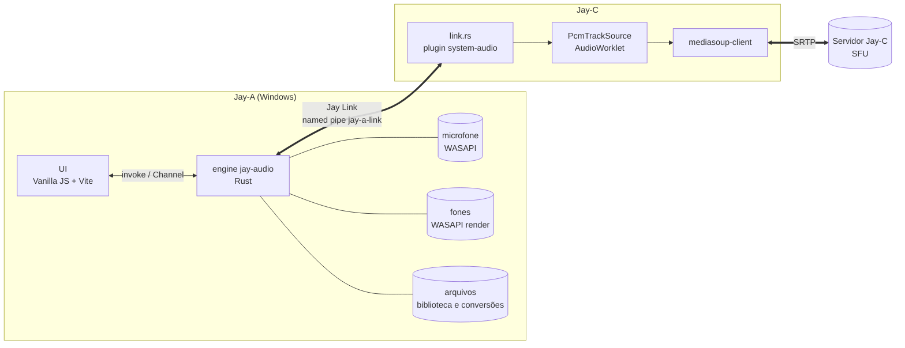
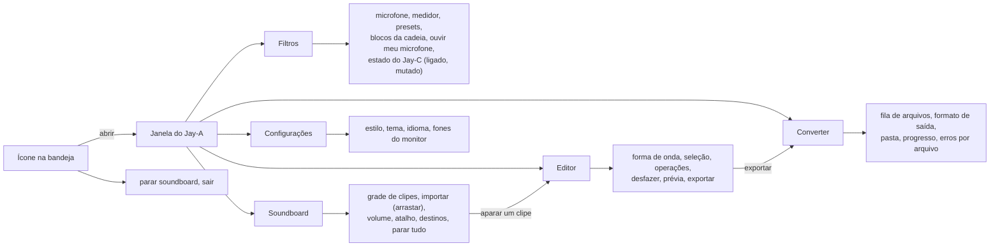
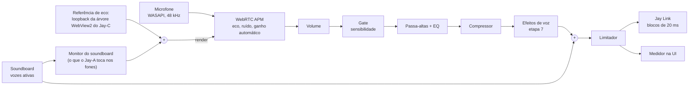
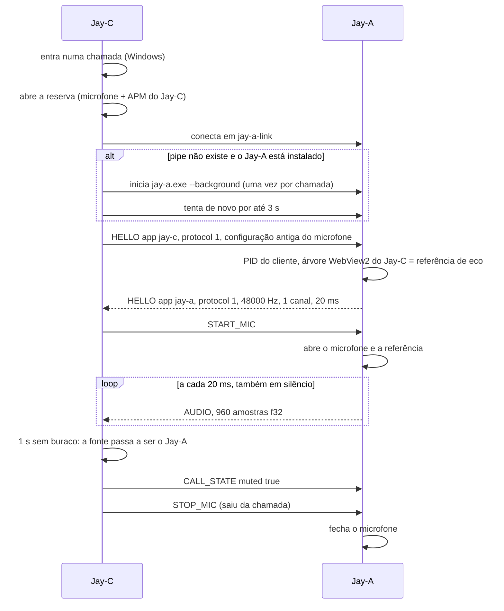
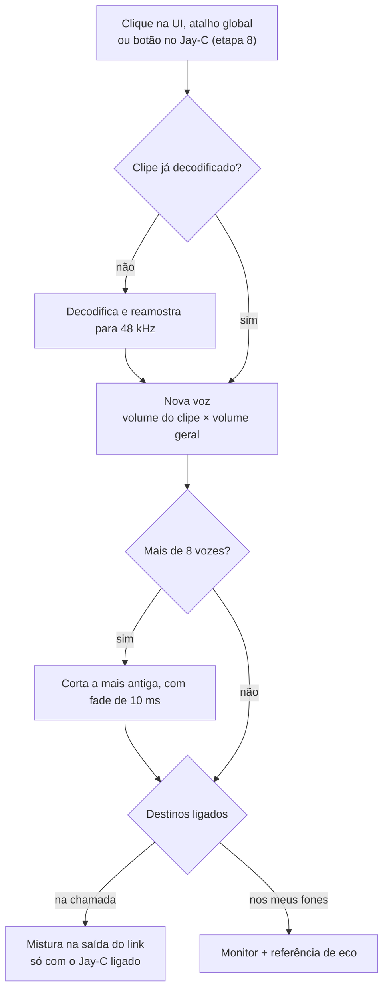
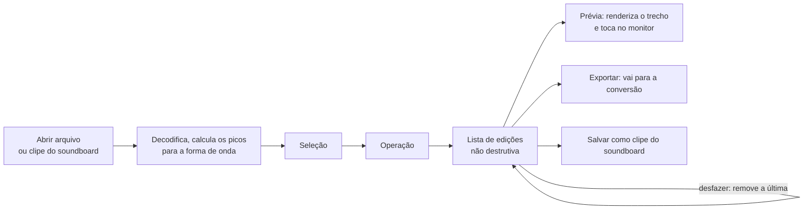
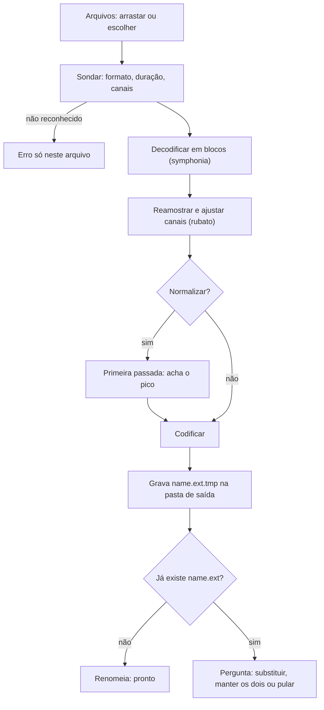

# Jay-A — Arquitetura

App de áudio da linha Jay: **filtros do microfone** (uma opção no Jay-C, no lugar do filtro dele, como o Krisp no Discord), **edição de áudio**, **soundboard** e **conversão de formatos**. Windows primeiro, como o áudio nativo do Jay-C.

Escrito em 2026-11-06, a partir do Jay-C 0.4.0 (`b30199a`). O lado do Jay-C da integração está no `docs/JAY-A.md` do repositório JayC (commit `ff5622f`). Só a etapa 0 foi implementada; o que depende de medição está marcado como spike.

## 1. Visão geral



- No Jay-C, a pessoa escolhe o **filtro do microfone**: Jay-A ou Jay-C. Com o Jay-A, ele captura, filtra, mistura o soundboard e entrega o áudio pronto ao Jay-C pelo **Jay Link**, um named pipe local.
- O **Jay-C** repassa esse áudio ao WebRTC pelo mesmo `PcmTrackSource` de hoje. Enquanto isso, mantém o próprio microfone e o APM rodando como **reserva quente**: se o Jay-A cair ou travar, o bloco seguinte já vem da reserva, sem trocar a faixa (`JAY-A.md`, seção 3). Servidor e sinalização não mudam.
- O filtro do Jay-C **continua existindo para sempre**, como opção e como reserva (D1 = b).
- O Jay-A roda na **bandeja**: fechar a janela não para os filtros. O microfone só fica aberto enquanto o Jay-C pede (ou durante um teste na UI), para o indicador de microfone do Windows não ficar aceso à toa.

| Função | Filtro Jay-C (hoje, continua) | Filtro Jay-A |
|---|---|---|
| Captura do microfone (WASAPI, modo compartilhado) | `system-audio/src/win.rs` | Jay-A; a reserva do Jay-C abre o mesmo microfone ao mesmo tempo |
| Eco, ruído, ganho automático (WebRTC APM) | `system-audio/src/apm.rs` | Jay-A |
| Volume e sensibilidade (gate) | `core/mic-shape.js` | Jay-A (portado para Rust); no Jay-C, só na reserva |
| Escolha do microfone | Settings › Audio do Jay-C | Jay-A; a reserva segue o mesmo (`deviceId`) |
| Alto-falante da chamada, mudo, ensurdecer | Jay-C | Jay-C (sem mudança) |
| Microfone no Android | `getUserMedia` | sem mudança (o Jay-A é só Windows) |

## 2. Decisões técnicas

| Tema | Escolha | Motivo |
|---|---|---|
| Shell e UI | **Tauri v2 + Vanilla JS + Vite**, como o Jay-C | Mesmo stack, mesma leveza. Copia do Jay-C `styles/theme.css`, os estilos Calmo/Neon/Suave, `ui/dom.js` (`h()`), `core/i18n.js` e `ui/icons.js`. |
| Ícones | **Os do Jay-C** (`src-tauri/icons/`, `app-icon.png`), copiados | Pedido do usuário. Trocar depois é um `npx tauri icon <png>`. |
| Engine | Crate Rust **`jay-audio`**, sem dependência do Tauri | Testes com `cargo test` sem compilar o app (como o plugin `system-audio` do Jay-C). Os comandos Tauri ficam em `src-tauri`. |
| Integração com o Jay-C | **Named pipe** `\\.\pipe\jay-a-link`, quadros opcode (u32 LE) + tamanho (u32 LE) + dados | É o formato que o `discord.rs` do Jay-C já fala, sem dependência nova. Sem porta TCP: nada de firewall, e o Windows informa o PID de quem conectou. |
| Filtros base | **WebRTC AudioProcessing**, copiado do Jay-C (`third_party/`, `jayc_apm.cpp`, `apm.rs`), que continua com o dele | Já está medido (33 dB de eco removidos) e é o mesmo do Chromium e do Discord. |
| Filtros próprios | Biquad (passa-altas, EQ), compressor, gate e limitador **escritos à mão** em Rust | Cada um tem 30–60 linhas (receitas RBJ). Não vale uma dependência. |
| Decodificar | **symphonia** (Rust puro, MPL-2.0) | MP3, AAC/M4A, FLAC, WAV, OGG Vorbis, ALAC, AIFF. Arquivos do usuário são entrada não confiável, e Rust puro evita bugs de memória num decodificador em C. |
| Reamostrar | **rubato** (MIT) | Tudo vira 48 kHz f32 dentro do engine. |
| Codificar | `hound` (WAV), `flacenc` (FLAC), `mp3lame-encoder` (MP3), `vorbis_rs` (OGG), `opus` + `ogg` (Opus) | Ver o spike S3: os três últimos compilam C e precisam ser testados com MSVC. |
| Por que não ffmpeg | — | Um ffmpeg completo tem ~80–130 MB, e a linha Jay é leve (o Jay-C tem 3,9 MB). E os efeitos dos arquivos seriam filtros do ffmpeg, diferentes dos do microfone: duas implementações. Com o engine próprio, **a mesma cadeia de filtros serve ao vivo e nos arquivos**. |
| Atalhos globais | `tauri-plugin-global-shortcut` | Tocar o soundboard com um jogo em foco. |
| Bandeja e instância única | `tray-icon` do Tauri + `tauri-plugin-single-instance` | O Jay-C pode iniciar o Jay-A sem abrir um segundo engine. |
| Persistência | **`config.json`** na pasta de configuração do app, lido pelo engine | O engine precisa dos filtros mesmo com a janela fechada, então a configuração não pode ficar no `localStorage` da página (como no Jay-C). A UI lê e grava por comandos. Até a etapa 3, as opções do microfone ficam no `localStorage`, porque só a página as usa. |
| Formato interno | 48 kHz, f32, quadros de 10 ms (480 amostras) | É o quadro do APM e do RNNoise. O link entrega blocos de 20 ms, como o microfone nativo do Jay-C hoje. |

## 3. Estrutura do repositório

```
Jay-A/
├─ package.json                  # npm workspaces: frontend
├─ docs/ARQUITETURA.md
├─ crates/jay-audio/             # engine: sem Tauri, testável com cargo test
│  ├─ build.rs                   # compila o WebRTC APM (Meson + MSVC), como no Jay-C
│  ├─ native/jayc_apm.cpp        # camada C do APM, igual à do Jay-C
│  ├─ third_party/webrtc-audio-processing/   # igual à do Jay-C
│  └─ src/
│     ├─ lib.rs                  # constantes, level_db
│     ├─ apm.rs                  # igual ao do Jay-C (com o teste de eco)
│     ├─ mic.rs                  # microfone WASAPI + APM (etapa 1, do win.rs do Jay-C)
│     ├─ monitor.rs              # "Ouvir meu microfone" (etapa 1)
│     ├─ loopback.rs             # referência de eco: process loopback do Jay-C (etapa 3)
│     ├─ dsp/                    # gate.rs, biquad.rs, compressor.rs, limiter.rs, chain.rs, presets.rs (etapa 2)
│     ├─ soundboard.rs           # biblioteca, vozes, mistura
│     ├─ files/                  # decode.rs, encode.rs, convert.rs, edit.rs (lista de edições), peaks.rs
│     └─ link.rs                 # servidor do Jay Link
├─ scripts/                      # dev-debug.ps1 (app com depuração na porta 9224) e cdp-eval.mjs (roda JS no app), do Jay-C
└─ frontend/
   ├─ index.html, vite.config.js, package.json
   ├─ src/
   │  ├─ main.js
   │  ├─ styles/                 # theme.css e app.css (base do Jay-C)
   │  ├─ core/                   # i18n.js, style.js, appearance.js (do Jay-C); engine.js (invoke + Channel)
   │  ├─ ui/                     # dom.js, icons.js, tabs.js (do Jay-C); filters.js, soundboard.js,
   │  │                          # editor.js, converter.js, settings-modal.js
   │  ├─ locales/pt-BR.js
   │  └─ store/settings.js       # só preferências da UI (tema, estilo, idioma)
   └─ src-tauri/
      ├─ tauri.conf.json         # productName "Jay-A", identifier io.github.tyxmatty.jaya
      ├─ icons/                  # cópia dos ícones do Jay-C
      └─ src/main.rs             # comandos → jay-audio, bandeja, instância única, atalhos
```

Não há servidor: o Jay-A é só local.

## 4. Interface



## 5. Filtros do microfone



- **Referência de eco:** a mesma técnica do Jay-C hoje (process loopback da árvore do `msedgewebview2.exe` filho do Jay-C), só que aberta de outro processo. O Jay-A acha essa árvore pelo PID de quem conectou no pipe (`GetNamedPipeClientProcessId`), sem confiar num PID mandado na mensagem. Spike S2.
- **O monitor entra na referência:** o soundboard tocado nos fones/alto-falantes pode voltar pelo microfone. Somando o que o Jay-A toca à referência, o AEC tira esse retorno e os outros não ouvem o clipe duas vezes.
- **O soundboard entra depois do gate e da supressão de ruído:** antes, a supressão trataria música como ruído e o gate cortaria clipes baixos. Ele só passa pelo limitador, que evita estourar quando voz e clipe somam.
- **Volume e gate** são o `mic-shape.js` do Jay-C portado para Rust, com o mesmo comportamento (hold de 300 ms e rampa por bloco, para não estalar) e os mesmos testes.
- **Presets** são cadeias salvas em JSON (ex.: "Voz limpa", "Podcast", "Rádio"). Trocar de preset ou mexer num controle vale no próximo quadro de 10 ms, sem reabrir o microfone. Os parâmetros mudam com rampa, para não estalar.
- **Ouvir meu microfone:** manda a saída da cadeia para os fones, para ajustar os filtros. Só com fones: nos alto-falantes, vira microfonia (aviso na UI).
- **Supressão de ruído forte (opcional, etapa 7):** RNNoise pelo crate `nnnoiseless` (Rust puro, BSD), também em quadros de 480 amostras.

**Threads do engine:**

| Thread | Faz | Nunca |
|---|---|---|
| Microfone | lê o WASAPI (**modo compartilhado**: a reserva do Jay-C abre o mesmo microfone) e enfileira | processa; abre em modo exclusivo |
| Referência | loopback do Jay-C, enfileira | — |
| DSP (relógio do microfone) | APM, cadeia, mistura do soundboard, limitador | lê disco ou espera o pipe |
| Monitor | toca soundboard e prévias nos fones (WASAPI render) | — |
| Link | aceita o Jay-C e escreve os blocos; fila de no máximo 5 blocos (100 ms), que volta a 40 ms quando passa disso, como as filas das capturas do Jay-C (`MAX_QUEUED_CHUNKS` em `win.rs`) | trava a thread DSP |
| Tarefas | conversões, exportações, picos da forma de onda | toca no áudio ao vivo |

## 6. Jay Link (integração com o Jay-C)

### Conexão



### O lado do Jay-C

Os estados, a reserva quente e o seletor são do Jay-C e estão no `JAY-A.md` dele (seções 3 e 4). O que importa para o Jay-A:
- **Estados:** Filtro do Jay-C, Procurando o Jay-A, Jay-A ligado, Reserva (o Jay-A não respondeu) e Incompatível (atualize o Jay-A). Só em "Jay-A ligado" o som que sai é o do Jay-A.
- **Travamento = 60 ms sem `AUDIO`.** Por isso o Jay-A manda `AUDIO` a cada 20 ms enquanto o microfone está ligado, também em silêncio (zeros com o gate fechado). Um Jay-A que fica 60 ms sem mandar perde a chamada para a reserva, e só volta depois de 1 s sem buraco.
- **Sem troca de faixa:** o seletor troca a fonte dentro do Rust do Jay-C, bloco a bloco. O JS do Jay-C pede `start_mic({ filter: "jay-a" })`, e os estados chegam em JSON pelo mesmo Channel do áudio.
- **Reconexão:** o Jay-C tenta de novo a cada 5 s (60 s se o protocolo for diferente) e inicia o Jay-A no máximo uma vez por chamada.

### Mensagens

Quadro: `opcode` (u32 LE) + `tamanho` (u32 LE) + dados. Controle em JSON; áudio em bytes crus.

| Opcode | Direção | Dados |
|---|---|---|
| 0 `HELLO` | C → A | `{ app: "jay-c", version, protocol: 1, import?: { micDevice, micGain, micGate, micProcessing } }` |
| 0 `HELLO` | A → C | `{ app: "jay-a", version, protocol: 1, sampleRate: 48000, channels: 1, frameMs: 20 }` ou `{ error }` e fecha |
| 1 `CONTROL` | C → A | `{ type: "start-mic" }`, `{ type: "stop-mic" }`, `{ type: "call-state", inCall, muted }`, `{ type: "show" }` (abrir a janela), `{ type: "soundboard-list" }`, `{ type: "soundboard-play", id }` (etapa 8) |
| 1 `CONTROL` | A → C | `{ type: "state", device, deviceId, preset }` (`deviceId`: o id do endpoint WASAPI, o mesmo do `list_mics` do Jay-C, para a reserva abrir o mesmo microfone), `{ type: "soundboard", clips: [{ id, name }] }`, `{ type: "error", message }` |
| 2 `AUDIO` | A → C | 960 × f32 LE (20 ms, mono, 48 kHz) = 3 840 bytes, **a cada 20 ms** enquanto o microfone está ligado, também em silêncio. O Jay-C fecha o link se o tamanho for outro e troca NaN/infinito por 0 |
| 3 `PING` / 4 `PONG` | os dois | — (a cada 5 s; sem resposta em 10 s = pipe morto) |

- **`import`:** na primeira conexão, se o Jay-A ainda não tem configuração, ele adota o microfone, o volume, o gate e os filtros que a pessoa já tinha ajustado no Jay-C.
- **Versão:** `protocol` diferente → o Jay-A responde `{ error }`, e o Jay-C vai para a reserva com o aviso "Atualize o Jay-A".
- **Mudo:** mutar no Jay-C pausa o producer, então o soundboard também fica mudo na chamada (D2). O `call-state` serve só para a UI do Jay-A mostrar "mutado no Jay-C".

### Instalação e início

- O instalador é por usuário (NSIS `currentUser`, como o Jay-C) e põe o app em `%LOCALAPPDATA%\Jay-A\jay-a.exe`. É ali que o Jay-C procura o Jay-A, para mostrar "não instalado" e para iniciá-lo.
- **`jay-a.exe --background`** abre só na bandeja, sem janela. Se o Jay-A já está aberto, a segunda execução sai na hora (instância única) e só mostra a janela da primeira quando **não** veio com `--background`.

### Segurança do pipe

- DACL só do usuário atual (`D:P(A;;GA;;;OW)`), `PIPE_REJECT_REMOTE_CLIENTS` e `FILE_FLAG_FIRST_PIPE_INSTANCE`: outro usuário do PC ou da rede não ouve o microfone, e um segundo Jay-A não abre outro pipe com o mesmo nome.
- O Jay-C não confere qual executável é o servidor: um programa malicioso rodando como o mesmo usuário já pode abrir o microfone sozinho, então a checagem não protegeria nada.
- Mensagens de controle com no máximo 64 KB; JSON inválido ou opcode desconhecido fecha a conexão.

## 7. Soundboard



- **Biblioteca:** importar copia o arquivo para `soundboard/` na pasta de dados do app. Os metadados ficam no `config.json`: `{ id, name, file, volume, hotkey?, color? }`.
- **Memória:** cada clipe é decodificado uma vez e fica na memória em 48 kHz estéreo f32 (~0,4 MB por segundo). Limite de 20 s por clipe na importação; para clipes mais longos, a importação oferece abrir no editor para aparar. *shortcut: tudo na memória; trocar por um cache LRU se a biblioteca passar de ~200 MB.*
- **Na chamada sai mono**, porque o microfone do Jay-C é mono; nos fones, estéreo.
- **Parar tudo:** botão, atalho global e item na bandeja.
- **Atalhos:** conflito com outro app → o registro falha e a UI mostra qual atalho não foi aceito.

## 8. Editor de áudio



| Operação | Como |
|---|---|
| Cortar, apagar trecho, manter só a seleção | índices de amostra |
| Fade in / fade out | rampa linear ou de potência igual |
| Ganho, normalizar (pico) | multiplicação; o pico vem da varredura do arquivo |
| Inverter | — |
| Velocidade (muda o tom junto) | rubato |
| Tom ou tempo separados | etapa 7, junto com os efeitos de voz (spike S4) |
| Aplicar preset de filtros | **a mesma cadeia do microfone**, rodando offline (sem AEC, que não tem referência num arquivo) |
| Tirar silêncio do começo e do fim | limiar em dBFS |

- O original nunca é alterado: o editor guarda a lista de edições e aplica tudo só na prévia e na exportação.
- A forma de onda é calculada no Rust (mínimo e máximo por coluna de pixels) e desenhada num `<canvas>`.
- *shortcut: o arquivo inteiro fica na memória (~1,4 GB por hora em estéreo); limite de 30 min no editor. A conversão em lote não tem esse limite, porque trabalha em blocos.*

## 9. Conversão



| Formato | Abrir | Salvar | Biblioteca |
|---|---|---|---|
| WAV | ✅ | ✅ (16/24 bits, 32 float) | symphonia / hound |
| FLAC | ✅ | ✅ | symphonia / flacenc |
| MP3 | ✅ | ✅ (CBR/VBR) | symphonia / mp3lame-encoder (LAME, LGPL: ok num app open-source, anotar na licença) |
| OGG Vorbis | ✅ | ✅ | symphonia / vorbis_rs |
| Opus (`.opus`) | ⚠️ symphonia não decodifica Opus até a 0.5 (verificar) → libopus | ✅ | opus + ogg |
| M4A / AAC | ✅ (AAC-LC) | ❌ fora do v1 | symphonia |
| AIFF, ALAC | ✅ | ❌ | symphonia |

- Opções de saída: formato, taxa de amostragem (original, 44,1 k, 48 k), canais (original, mono, estéreo), bitrate ou qualidade, normalizar.
- **Lote:** uma tarefa por núcleo (`available_parallelism`), progresso por arquivo num `Channel`, cancelar a qualquer momento (apaga o `.tmp`).
- **Segurança:** arquivo de entrada é dado não confiável. Limite de tamanho (2 GB) e de duração (10 h); um erro de decodificação vira erro daquele arquivo, nunca derruba o app nem a fila. O arquivo de entrada nunca é sobrescrito sem perguntar.

## 10. Mudanças no Jay-C

O plano e a lista de arquivos são do Jay-C: `docs/JAY-A.md`, seções 6 e 7, com as etapas I1–I7 na seção 10. Em resumo:
- **Plugin `system-audio`:** `link.rs` (cliente do Jay Link, no formato do `discord.rs`), `selector.rs` (troca a fonte bloco a bloco) e o modo Jay-A no `Mic` (`start_mic({ filter: "jay-a" })`), com os estados em JSON pelo mesmo Channel.
- **Interface:** Settings › Áudio › Filtro do microfone (Jay-A ou Jay-C), o estado do link, o botão "Abrir Jay-A" e os avisos de troca. Os ajustes do filtro do Jay-C continuam, porque valem na reserva.
- **Nada é removido do Jay-C** (D1 = b): o APM, o `mic-shape.js` e o build com Meson ficam.
- **Para testar este lado:** o Jay-C vai ter um Jay-A falso (`cargo run --example fake_jay_a`) e um cliente de teste (`cargo run --example jay_a_probe`), que pede o microfone ao Jay-A por 30 s e passa se não houver buraco maior que 60 ms entre blocos.

## 11. Riscos e spikes

| # | Spike | Pronto quando |
|---|---|---|
| S1 | Latência do link: bloco de 20 ms pelo pipe até o `Channel` do Jay-C | o `jay_a_probe` do Jay-C passa (nenhum buraco > 60 ms); atraso extra medido pela correlação com a reserva do Jay-C, meta ≤ 5 ms no p99 |
| S2 | AEC com a referência aberta por outro processo | o teste de eco do Jay-C repetido com o Jay-A abrindo o loopback do Jay-C; mesma remoção (~33 dB) |
| S3 | Codificadores com MSVC (`mp3lame-encoder`, `vorbis_rs`, `opus`) e decodificação de Opus | os três compilam no Windows; um WAV vira MP3, OGG e Opus que tocam no navegador |
| S4 | Tom/tempo ao vivo (ex.: `signalsmith-stretch`) | latência e CPU medidas com voz real |

Riscos:
1. **Dois apps para a experiência completa.** Se o Jay-A travar no meio da chamada, a reserva quente do Jay-C assume no bloco seguinte. O risco que sobra é o Jay-A ficar lento sem parar: blocos atrasados mais de 60 ms fazem a fonte pular para a reserva. Medir no S1.
2. **Pasta no OneDrive.** O repositório ficou no OneDrive (escolha do usuário). O build do Rust vai para fora dele pelo `.cargo/config.toml` local (`target-dir`), como no Jay-C; o `node_modules` fica no OneDrive.
3. **APM duplicado para sempre** (D1 = b): o mesmo `third_party/webrtc-audio-processing` nos dois repositórios. Uma correção de segurança nele precisa ir aos dois.
4. **Dois microfones abertos ao mesmo tempo** (o do Jay-A e a reserva do Jay-C). Os dois em modo compartilhado; o Jay-C mede a CPU e confirma que os outros apps não abafam (spike 09 dele).
5. **Licenças:** WebRTC APM (BSD), symphonia (MPL-2.0, por arquivo), LAME (LGPL), libopus e libvorbis (BSD). Todas compatíveis com um app MIT open-source; listar no README.
6. **Só Windows ao vivo** (WASAPI). Editor e conversão poderiam rodar em outros sistemas depois, mas não é meta do v1.

## 12. Etapas

Cada etapa termina com algo testável.

| # | Etapa | Pronto quando |
|---|---|---|
| 0 ✅ | Scaffold: Tauri v2 + Vite + Vanilla JS, ícones e estilos do Jay-C, bandeja, instância única, `--background` | `npm run dev` abre o Jay-A nos 3 estilos; fechar a janela deixa o ícone na bandeja |
| 1 ✅ | Engine: microfone WASAPI (modo compartilhado) + APM (copiados do Jay-C), monitor e medidor | o teste de eco do Jay-C passa no `jay-audio`; o medidor mostra a voz; "Ouvir meu microfone" funciona |
| 2 | Cadeia de filtros, presets e a aba Filtros | cada bloco tem teste com sinal sintético (ex.: o passa-altas de 80 Hz tira ≥ 20 dB a 20 Hz); trocar preset ao vivo sem estalo |
| 3 | Servidor do Jay Link (S1, S2), junto com a I5 do Jay-C | o `jay_a_probe` do Jay-C passa; numa chamada, o outro lado ouve a voz filtrada pelo Jay-A; fechar o Jay-A não corta a voz (a reserva assume); o som de outros apps continua sem abafar (−7,8 dB, spike 09 do Jay-C) |
| 4 | Soundboard | um clipe tocado por atalho, com um jogo em foco, chega à chamada e aos fones sem voltar como eco |
| 5 | Conversão (S3) | lote de 10 arquivos mistos para WAV, FLAC, MP3, OGG e Opus; um arquivo corrompido falha sozinho e os outros saem |
| 6 | Editor | cortar, fade, normalizar e exportar; desfazer volta ao estado anterior; a prévia toca no monitor |
| 7 | Efeitos de voz ao vivo (tom, robô, reverb) + RNNoise (S4) | efeitos ao vivo com a latência extra medida (meta ≤ 40 ms) |
| 8 | Soundboard dentro do Jay-C | o botão na barra da chamada lista e toca os clipes do Jay-A |
| 9 | Release: instalador NSIS do Jay-A em `%LOCALAPPDATA%\Jay-A`; o Jay-C oferece o Jay-A | os dois instalados numa máquina limpa fazem uma chamada filtrada; o Jay-C sozinho continua funcionando com o filtro dele |

**Etapa 1, medido (2026-11-06):**
- **Teste de eco** (`cargo test`): −35,0 dB sem AEC e −68,2 dB com AEC, 33 dB removidos, igual ao Jay-C.
- **Monitor** (`cargo test -- --ignored`): um tom de 440 Hz a −29 dBFS empurrado no monitor sai na saída padrão a −35,2 dBFS, medido no loopback dela; antes, silêncio digital.
- **No app, pela depuração remota:** a lista de microfones aparece, e o teste abre e fecha sem erro. Trocar de microfone, de supressão de ruído ou de ganho reabre o microfone na hora. Ligar e desligar o monitor durante o teste não dá erro. Fechar a janela para a bandeja encerra o teste.
- **Não visto:** o medidor com uma voz de verdade. Neste PC, os microfones são todos virtuais e estavam mudos: o Voicemeeter estava fechado, o Iriun desligado e o Virtual Desktop sem headset. A captura é o código do Jay-C, já medido lá. Também não foi medido se o monitor estala.

## 13. Decisões em aberto

| # | Pergunta | Opções (recomendada primeiro) |
|---|---|---|
| D1 ✅ | O que o Jay-C faz **sem** o Jay-A instalado? | **Decidido: (b).** O Jay-C mantém o filtro próprio para sempre, como opção e como reserva quente. Pedido do usuário no chat do Jay-C: "fallback caso caia e opção para escolher entre o Jay-A ou o Jay-C nativo". |
| D2 | Soundboard com o microfone mutado no Jay-C | **(a)** mutar silencia tudo: o soundboard vai junto com o microfone, sem mudar servidor nem protocolo · (b) faixa própria `soundboard` no SFU (muda o servidor, a sinalização e a UI de quem recebe) |
| D3 | "Modificação de áudio" | assumido: editor de arquivos (etapa 6) **e** efeitos de voz ao vivo (etapa 7). Confirmar se os dois são desejados |
| D4 | Microfone virtual para outros apps (Discord, OBS) | fora do escopo: exige um driver de áudio assinado. Alternativa sem driver: o usuário instala o VB-Cable e o Jay-A toca nele |
| D5 | Versão em inglês desta documentação | depois, como o `ARQUITETURA.en.md` do Jay-C |
