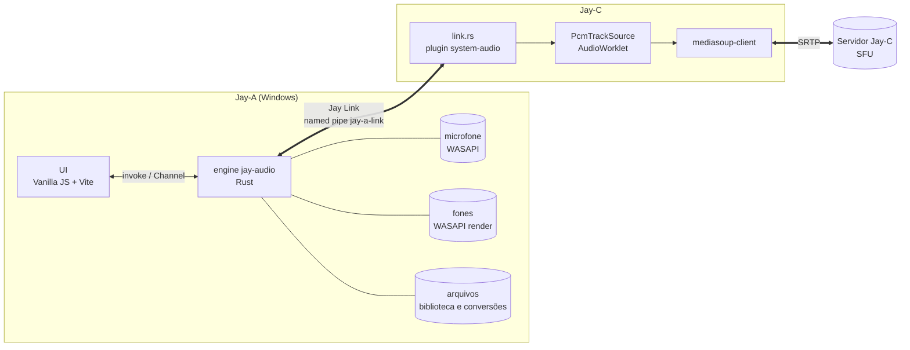
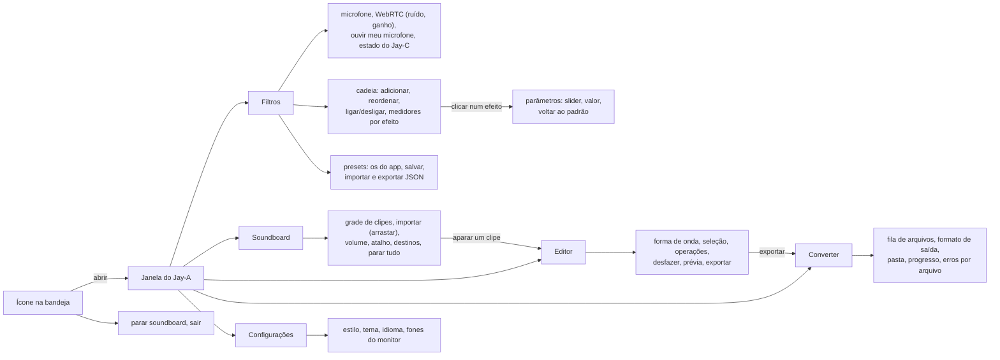
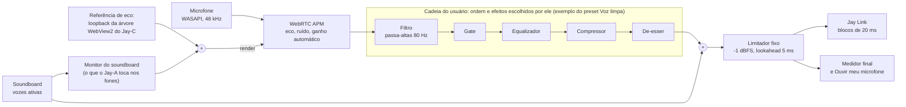
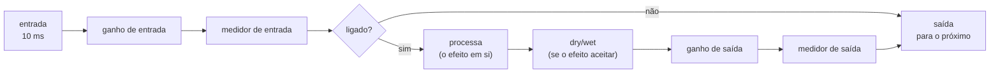
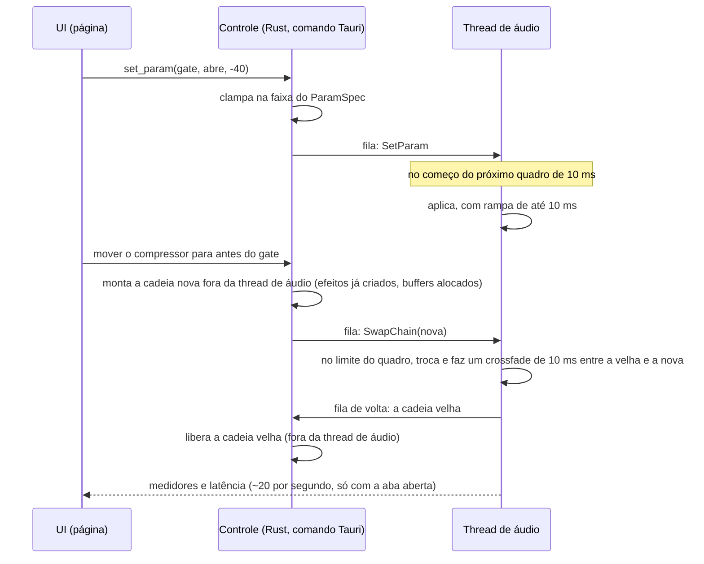
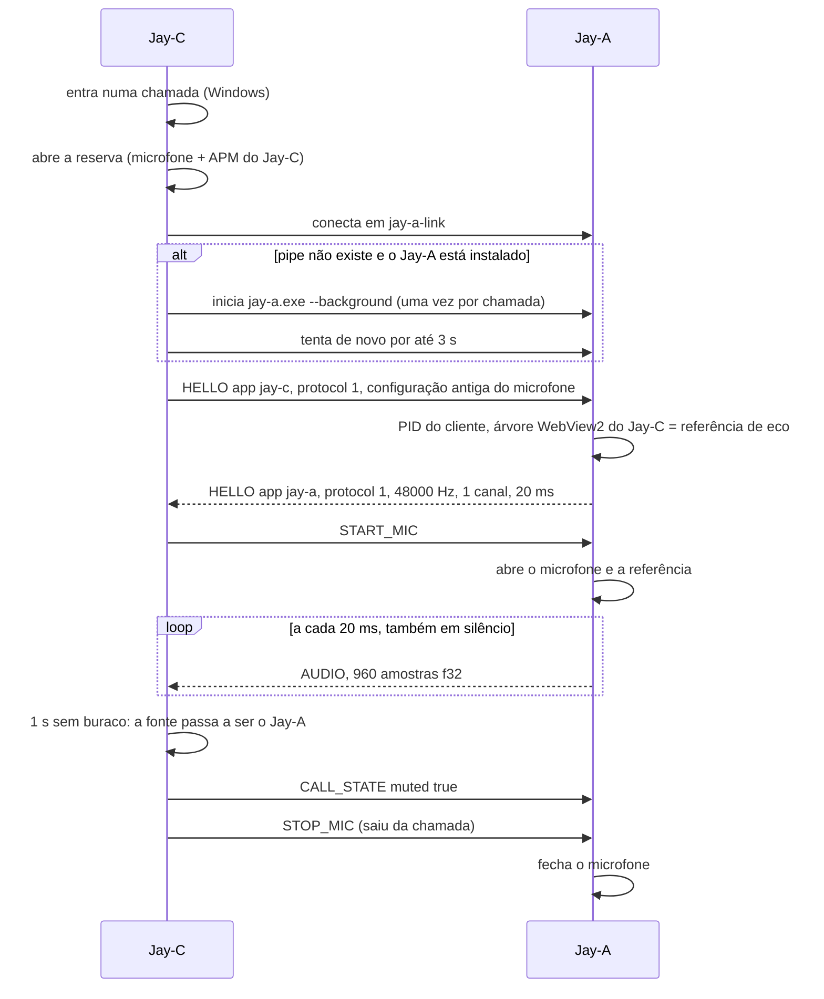
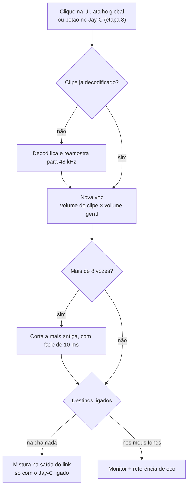
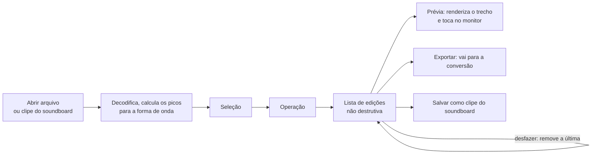
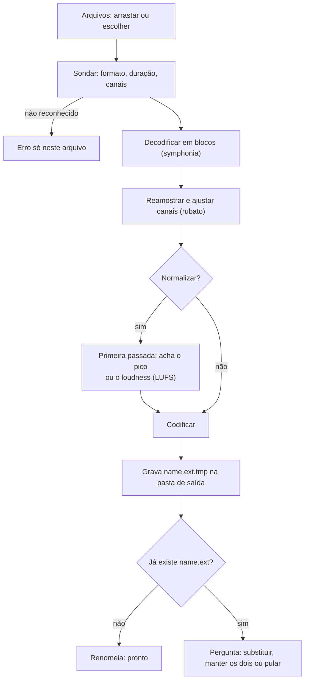

# Jay-A — Arquitetura

App de áudio da linha Jay: **filtros do microfone** (uma opção no Jay-C, no lugar do filtro dele, como o Krisp no Discord), **edição de áudio**, **soundboard** e **conversão de formatos**. Windows primeiro, como o áudio nativo do Jay-C.

Escrito em 2026-11-06, a partir do Jay-C 0.4.0 (`b30199a`). O lado do Jay-C da integração está no `docs/JAY-A.md` do repositório JayC. As etapas 0 e 1 estão prontas; o que depende de medição está marcado como spike. O estudo do EasyEffects e do Carla, que embasa a cadeia de efeitos (seção 5), está em [`REFERENCIAS.md`](REFERENCIAS.md). Licença: **MIT** (D6).

## 1. Visão geral



- No Jay-C, a pessoa escolhe o **filtro do microfone**: Jay-A ou Jay-C. Com o Jay-A, ele captura, filtra, mistura o soundboard e entrega o áudio pronto ao Jay-C pelo **Jay Link**, um named pipe local.
- O **Jay-C** repassa esse áudio ao WebRTC pelo mesmo `PcmTrackSource` de hoje. Enquanto isso, mantém o próprio microfone e o APM rodando como **reserva quente**: se o Jay-A cair ou travar, o bloco seguinte já vem da reserva, sem trocar a faixa (`JAY-A.md`, seção 3). Servidor e sinalização não mudam.
- O filtro do Jay-C **continua existindo para sempre**, como opção e como reserva (D1 = b).
- O Jay-A roda na **bandeja**: fechar a janela não para os filtros. O microfone só fica aberto enquanto o Jay-C pede (ou durante um teste na UI), para o indicador de microfone do Windows não ficar aceso à toa.

| Função | Filtro Jay-C (hoje, continua) | Filtro Jay-A |
|---|---|---|
| Captura do microfone (WASAPI, modo compartilhado) | `system-audio/src/win.rs` | Jay-A; a reserva do Jay-C abre o mesmo microfone ao mesmo tempo |
| Eco, ruído, ganho automático (WebRTC APM) | `system-audio/src/apm.rs` | Jay-A |
| Volume e sensibilidade (gate) | `core/mic-shape.js` | Jay-A (portado para Rust); no Jay-C, só na reserva |
| Escolha do microfone | Settings › Audio do Jay-C | Jay-A; a reserva segue o mesmo (`deviceId`) |
| Alto-falante da chamada, mudo, ensurdecer | Jay-C | Jay-C (sem mudança) |
| Microfone no Android | `getUserMedia` | sem mudança (o Jay-A é só Windows) |

### Requisitos funcionais

| # | Requisito | Etapa |
|---|---|---|
| RF-F1 | Escolher o microfone (lista do Windows ou o padrão) e testá-lo com um medidor | 1 ✅ |
| RF-F2 | Ligar e desligar o processamento do WebRTC: supressão de ruído e ganho automático (o cancelamento de eco liga com o Jay Link) | 1 ✅ / 3 |
| RF-F3 | Montar a **cadeia de efeitos**: adicionar, remover, duplicar e **reordenar** efeitos, e ligar ou desligar cada um sem tirá-lo da cadeia | 2 |
| RF-F4 | Ajustar cada parâmetro dentro da faixa dele (slider, valor digitado e "voltar ao padrão"), com efeito no próximo quadro e sem estalo | 2 |
| RF-F5 | Ver o nível na entrada e na saída de cada efeito, o nível final e a latência total da cadeia | 2 |
| RF-F6 | Presets: os que vêm com o app, salvar o atual, importar e exportar em JSON | 2 |
| RF-F7 | "Ouvir meu microfone": a saída da cadeia nos fones | 1 ✅ |
| RF-F8 | Supressão de ruído forte (RNNoise, DeepFilterNet) e efeitos de voz (tom, robô, reverb) | 7 |
| RF-L1 | Servir o Jay Link ao Jay-C: `HELLO`, microfone sob pedido, `AUDIO` a cada 20 ms, estado com `deviceId` | 3 |
| RF-L2 | Abrir só na bandeja com `--background`; instância única | 0 ✅ |
| RF-S1 | Soundboard: importar clipes, tocar por clique ou atalho global, escolher os destinos (chamada, fones), volume por clipe e parar tudo | 4 |
| RF-E1 | Editor: cortar, fade, ganho, normalizar (pico ou LUFS), inverter, velocidade, aplicar um preset de filtros; desfazer, prévia, exportar | 6 |
| RF-C1 | Conversão em lote entre WAV, FLAC, MP3, OGG e Opus (abre também M4A/AAC, AIFF, ALAC), com cancelar e sem sobrescrever sem perguntar | 5 |
| RF-A1 | Os três estilos e os temas do Jay-C, inglês e português, bandeja com Abrir e Sair | 0 ✅ |

### Requisitos não funcionais

| # | Requisito | Como medir |
|---|---|---|
| RNF-1 Latência | A cadeia da etapa 2 soma no máximo **5 ms** (o lookahead do limitador; filtros IIR, gate e compressor não atrasam). Com a supressão forte, até **40 ms**. O link soma no máximo 5 ms no p99 sobre o microfone nativo do Jay-C | a latência que cada efeito informa; a correlação com a reserva do Jay-C (S1) |
| RNF-2 Continuidade | Com o microfone ligado, um bloco de `AUDIO` a cada 20 ms, também em silêncio; **nenhum intervalo acima de 60 ms** | `jay_a_probe` do Jay-C por 30 s |
| RNF-3 Tempo real | A thread de áudio **nunca espera**: não pega lock bloqueante, não aloca memória, não lê disco nem pipe. Mudanças chegam por fila e entram entre quadros (seção 5) | revisão de código; teste que mexe nos parâmetros 1 000 vezes por segundo sem buraco |
| RNF-4 Sem estalo | Mudar parâmetro, ligar/desligar efeito, reordenar e trocar preset fazem rampa de no máximo 10 ms; nenhum degrau na saída | teste com seno: a maior diferença entre amostras vizinhas não cresce na troca |
| RNF-5 CPU | A cadeia da etapa 2, com todos os efeitos ligados, gasta menos de **2% de um núcleo** a 48 kHz mono (Ryzen 5 5600G, a máquina dos números do Jay-C) | teste de desempenho com 60 s de áudio |
| RNF-6 Robustez | Microfone desconectado, arquivo corrompido ou atalho recusado viram um aviso na tela; nada derruba o app nem a chamada | os testes de cada etapa |
| RNF-7 Privacidade | O microfone só abre quando o Jay-C pede ou num teste na tela; fechar a janela encerra o teste. Nenhum áudio sai do computador pelo Jay-A | o indicador de microfone do Windows |
| RNF-8 Segurança | O pipe só aceita o usuário atual e nada de rede (seção 6); arquivos de áudio são entrada não confiável, com limites de tamanho e duração; decodificadores em Rust onde houver | revisão; arquivos corrompidos nos testes da conversão |
| RNF-9 Plataforma | Windows 10 2004 ou mais novo, x64, WebView2 | — |
| RNF-10 Licença | O Jay-A é **MIT**. Dependências permissivas (MIT, BSD, Apache, MPL por arquivo); LGPL só se o usuário puder trocar a biblioteca (é o caso num app de código aberto). Código GPL, como o do EasyEffects e o do Carla, não entra | `cargo tree` e `package-lock.json` revisados a cada dependência nova |
| RNF-11 Acessibilidade e idioma | Tudo funciona pelo teclado, com rótulos para leitor de tela; contraste dos estilos do Jay-C; todo texto em inglês e em português | `npm test` (o teste de traduções) |
| RNF-12 Tamanho | Instalador de até 20 MB, contando os modelos de supressão de ruído (o Jay-C tem 1,5 MB) | o `.exe` do instalador |

## 2. Decisões técnicas

| Tema | Escolha | Motivo |
|---|---|---|
| Shell e UI | **Tauri v2 + Vanilla JS + Vite**, como o Jay-C | Mesmo stack, mesma leveza. Copia do Jay-C `styles/theme.css`, os estilos Calmo/Neon/Suave, `ui/dom.js` (`h()`), `core/i18n.js` e `ui/icons.js`. |
| Ícones | **Os do Jay-C** (`src-tauri/icons/`, `app-icon.png`), copiados | Pedido do usuário. Trocar depois é um `npx tauri icon <png>`. |
| Engine | Crate Rust **`jay-audio`**, sem dependência do Tauri | Testes com `cargo test` sem compilar o app (como o plugin `system-audio` do Jay-C). Os comandos Tauri ficam em `src-tauri`. |
| Integração com o Jay-C | **Named pipe** `\\.\pipe\jay-a-link`, quadros opcode (u32 LE) + tamanho (u32 LE) + dados | É o formato que o `discord.rs` do Jay-C já fala, sem dependência nova. Sem porta TCP: nada de firewall, e o Windows informa o PID de quem conectou. |
| Filtros base | **WebRTC AudioProcessing**, copiado do Jay-C (`third_party/`, `jayc_apm.cpp`, `apm.rs`), que continua com o dele | Já está medido (33 dB de eco removidos) e é o mesmo do Chromium e do Discord. |
| Filtros próprios | Biquad (filtros e EQ), gate, compressor, de-esser e limitador **escritos à mão** em Rust | Cada um tem 30–80 linhas (receitas RBJ para os biquads). Não vale uma dependência, e o código GPL do EasyEffects não pode entrar. |
| Cadeia de efeitos | **Rack**: uma lista ordenada de instâncias (`gate#0`, `eq#1`) que a pessoa monta, como o EasyEffects e o modo rack do Carla | A ordem certa depende da voz e do microfone; uma ordem fixa não serve a todos. O patchbay (grafo livre) do Carla é poder demais para voz. |
| Parâmetros | Cada parâmetro tem padrão, mínimo, máximo, passo e escala (linear, logarítmica, dB), e todo valor recebido é clampado, como os `ParameterRanges` do Carla | A UI gera os controles a partir da descrição, e um preset com valor fora da faixa não quebra nada |
| Supressão de ruído forte | `nnnoiseless` (RNNoise em Rust, BSD) e `libDF` (DeepFilterNet em Rust, MIT/Apache) | As mesmas que o EasyEffects usa, com licenças compatíveis com MIT |
| Loudness | `ebur128` (MIT) | Normalizar em LUFS no editor e na conversão, como o autogain do EasyEffects (libebur128) |
| Licença | **MIT** (D6), arquivo `LICENSE` | Igual ao Jay-C |
| Decodificar | **symphonia** (Rust puro, MPL-2.0) | MP3, AAC/M4A, FLAC, WAV, OGG Vorbis, ALAC, AIFF. Arquivos do usuário são entrada não confiável, e Rust puro evita bugs de memória num decodificador em C. |
| Reamostrar | **rubato** (MIT) | Tudo vira 48 kHz f32 dentro do engine. |
| Codificar | `hound` (WAV), `flacenc` (FLAC), `mp3lame-encoder` (MP3), `vorbis_rs` (OGG), `opus` + `ogg` (Opus) | Ver o spike S3: os três últimos compilam C e precisam ser testados com MSVC. |
| Por que não ffmpeg | — | Um ffmpeg completo tem ~80–130 MB, e a linha Jay é leve (o Jay-C tem 3,9 MB). E os efeitos dos arquivos seriam filtros do ffmpeg, diferentes dos do microfone: duas implementações. Com o engine próprio, **a mesma cadeia de filtros serve ao vivo e nos arquivos**. |
| Atalhos globais | `tauri-plugin-global-shortcut` | Tocar o soundboard com um jogo em foco. |
| Bandeja e instância única | `tray-icon` do Tauri + `tauri-plugin-single-instance` | O Jay-C pode iniciar o Jay-A sem abrir um segundo engine. |
| Persistência | **`config.json`** na pasta de configuração do app, lido pelo engine | O engine precisa dos filtros mesmo com a janela fechada, então a configuração não pode ficar no `localStorage` da página (como no Jay-C). A UI lê e grava por comandos. Desde a 2c, a cadeia já fica no motor (`chain.json`, e os presets do usuário em `presets/`); as opções do microfone (dispositivo, supressão de ruído, ganho automático) seguem no `localStorage` até a etapa 3. |
| Formato interno | 48 kHz, f32, quadros de 10 ms (480 amostras) | É o quadro do APM e do RNNoise. O link entrega blocos de 20 ms, como o microfone nativo do Jay-C hoje. |

## 3. Estrutura do repositório

```
Jay-A/
├─ package.json                  # npm workspaces: frontend
├─ LICENSE                       # MIT
├─ docs/ARQUITETURA.md, docs/REFERENCIAS.md   # este plano; o estudo do EasyEffects e do Carla
├─ crates/jay-audio/             # engine: sem Tauri, testável com cargo test
│  ├─ build.rs                   # compila o WebRTC APM (Meson + MSVC), como no Jay-C
│  ├─ native/jayc_apm.cpp        # camada C do APM, igual à do Jay-C
│  ├─ third_party/webrtc-audio-processing/   # igual à do Jay-C
│  └─ src/
│     ├─ lib.rs                  # constantes, level_db
│     ├─ apm.rs                  # igual ao do Jay-C (com o teste de eco)
│     ├─ mic.rs                  # microfone WASAPI + APM (etapa 1, do win.rs do Jay-C)
│     ├─ monitor.rs              # "Ouvir meu microfone" (etapa 1)
│     ├─ loopback.rs             # referência de eco: process loopback do Jay-C (etapa 3)
│     ├─ dsp/                    # 2a ✅: params.rs (ParamSpec, controles comuns), effect.rs (Effect, lista
│     │                          # de efeitos), chain.rs (rack, troca sem lock, crossfade), preset.rs (JSON);
│     │                          # 2b ✅: effects/ biquad, filter, eq, gate, compressor, deesser, limiter;
│     │                          # 7: denoise, pitch, robot, reverb
│     ├─ presets/                # os presets que vêm com o app (clean-voice, podcast, noise-only, radio)
│     ├─ soundboard.rs           # biblioteca, vozes, mistura
│     ├─ files/                  # decode.rs, encode.rs, convert.rs, edit.rs (lista de edições), peaks.rs
│     └─ link.rs                 # servidor do Jay Link
├─ scripts/                      # dev-debug.ps1 (app com depuração na porta 9224) e cdp-eval.mjs (roda JS no app), do Jay-C
└─ frontend/
   ├─ index.html, vite.config.js, package.json
   ├─ src/
   │  ├─ main.js
   │  ├─ styles/                 # theme.css e app.css (base do Jay-C)
   │  ├─ core/                   # i18n.js, style.js, appearance.js (do Jay-C); engine.js (invoke + Channel)
   │  ├─ ui/                     # dom.js, icons.js, tabs.js (do Jay-C); filters.js, soundboard.js,
   │  │                          # editor.js, converter.js, settings-modal.js
   │  ├─ locales/pt-BR.js
   │  └─ store/settings.js       # só preferências da UI (tema, estilo, idioma)
   └─ src-tauri/
      ├─ tauri.conf.json         # productName "Jay-A", identifier io.github.tyxmatty.jaya
      ├─ icons/                  # cópia dos ícones do Jay-C
      └─ src/main.rs             # comandos → jay-audio, bandeja, instância única, atalhos
```

Não há servidor: o Jay-A é só local.

## 4. Interface



## 5. Filtros do microfone

### O caminho do áudio



- **Três partes:** uma frente fixa (microfone e WebRTC APM), a **cadeia do usuário** no meio, e um fim fixo (soundboard e limitador). A pessoa só mexe na cadeia do meio.
- **O WebRTC APM fica sempre na frente:** o cancelamento de eco precisa do sinal do microfone sem nenhum efeito antes, para o filtro adaptativo achar o eco. O EasyEffects deixa o echo canceller em qualquer posição; aqui ele não sai do lugar.
- **O limitador fica sempre no fim:** voz mais soundboard nunca passam de −1 dBFS, nem com um preset ruim.
- **Referência de eco:** a mesma técnica do Jay-C hoje (process loopback da árvore do `msedgewebview2.exe` filho do Jay-C), só que aberta de outro processo. O Jay-A acha essa árvore pelo PID de quem conectou no pipe (`GetNamedPipeClientProcessId`), sem confiar num PID mandado na mensagem. Spike S2.
- **O monitor entra na referência:** o soundboard tocado nos fones/alto-falantes pode voltar pelo microfone. Somando o que o Jay-A toca à referência, o AEC tira esse retorno e os outros não ouvem o clipe duas vezes.
- **O soundboard entra depois da cadeia:** antes dela, a supressão trataria música como ruído e o gate cortaria clipes baixos. Ele só passa pelo limitador.
- **Ouvir meu microfone:** manda a saída para os fones, para ajustar os filtros. Só com fones: nos alto-falantes, vira microfonia (aviso na UI).

### Um efeito da cadeia

Todo efeito ganha os mesmos controles, aplicados pelo host do mesmo jeito para todos (a ideia dos controles de entrada/saída do EasyEffects e do pós-processamento do Carla):



```rust
// crates/jay-audio/src/dsp/effect.rs (etapa 2a): o que cada efeito implementa.
pub trait Effect: Send {                           // roda na thread de áudio: sem alocar, sem lock
    fn set_param(&mut self, index: usize, value: f32); // já clampado; o efeito faz a rampa
    fn process(&mut self, frame: &mut [f32]);       // 10 ms (480 amostras), mono, no lugar
    fn latency(&self) -> usize { 0 }                // lida ao montar a cadeia
    fn reset(&mut self);                            // ao montar e ao religar: limpa envelopes e filtros
}
pub struct EffectInfo { pub kind: &'static str, pub params: &'static [ParamSpec], pub create: fn() -> Box<dyn Effect> }

// dsp/params.rs: o que um parâmetro aceita; COMMON são os controles que o host dá a todo efeito.
pub struct ParamSpec { pub key: &'static str, pub min: f32, pub max: f32, pub default: f32, pub step: f32, pub scale: Scale, pub unit: &'static str }
pub enum Scale { Linear, Log, Db, Toggle, Choice(&'static [&'static str]) }
```

- **A latência é lida quando a cadeia é montada.** Um parâmetro que muda a latência (o lookahead do limitador) monta a cadeia de novo, com o crossfade de sempre.

- **Desligar um efeito** passa o áudio direto, com uma rampa de 10 ms entre o processado e o original. Ao religar, o efeito chama `reset()`, para não soltar um envelope velho.
- **Latência:** cada efeito informa a sua. A cadeia soma e mostra o total na tela (RNF-1). O dry/wet de um efeito com latência atrasa o sinal seco na mesma medida.
- **Medidores:** pico e RMS de entrada e de saída de cada efeito, mandados à tela umas 20 vezes por segundo, só enquanto a aba Filtros está aberta.

### Catálogo de efeitos

As faixas partem das do EasyEffects (`REFERENCIAS.md`, seção 1.3), ajustadas para voz ao vivo. Todos aceitam ganho de entrada e de saída (−24 a +24 dB) e liga/desliga.

| Efeito | Parâmetros: padrão [faixa] | Latência | Etapa |
|---|---|---|---|
| **Filtro** (biquad) | tipo: passa-altas, passa-baixas, shelf grave, shelf agudo, bell, notch; frequência 80 Hz [20..20000, log]; Q 0,71 [0,1..10]; ganho 0 dB [−24..24]; inclinação 12 ou 24 dB/oitava | 0 | 2 |
| **Gate** | abre em −45 dB [−80..0]; **histerese** 6 dB [0..20] (fecha em −51 dB); attack 2 ms [0..50]; **hold** 300 ms [0..1000], como o do Jay-C; release 150 ms [5..2000]; redução −60 dB [−80..0] | 0 | 2 |
| **Equalizador** | até 10 bandas, cada uma um Filtro acima; padrão: 5 bandas planas (100, 300, 1k, 3k, 8k Hz) | 0 | 2 |
| **Compressor** | limiar −18 dB [−60..0]; ratio 3 [1..20]; joelho 6 dB [0..24]; attack 10 ms [0,1..200]; release 120 ms [10..2000]; makeup 0 dB [0..24]; detecção RMS ou pico; dry/wet | 0 | 2 |
| **De-esser** | frequência 6 kHz [3000..12000]; limiar −18 dB [−60..0]; ratio 3 [1..20]; um crossover Linkwitz-Riley de 24 dB/oitava separa os agudos (as duas metades somam de volta a um nível plano), e só eles são comprimidos | 0 | 2 |
| **Limitador** (fixo no fim; também pode entrar na cadeia) | limiar −1 dBFS [−24..0]; lookahead 5 ms [1..10]; release 50 ms [5..500] | lookahead | 2 |
| **Supressão de ruído forte** | modelo: RNNoise (`nnnoiseless`) ou DeepFilterNet (`libDF`); RNNoise: VAD com limiar 50% [0..100] e release 200 ms [0..2000]; DeepFilterNet: limite de atenuação 30 dB [0..100]; dry/wet | RNNoise ~10 ms; DeepFilterNet medir (S5) | 7 |
| **Tom** | semitons 0 [−12..12], cents 0 [−100..100]; dry/wet | medir (S4) | 7 |
| **Robô** | modulação em anel: frequência 50 Hz [10..500]; dry/wet | 0 | 7 |
| **Reverb** | tamanho, amortecimento, pré-delay; dry/wet | 0 | 7 |

Fora do catálogo do v1 (estão no EasyEffects, mas não ajudam numa chamada de voz ou custam latência): convolver, crossfeed e ferramentas de estéreo, multibanda, bass enhancer, exciter, autotune e harmonizer.

### Tempo real

A thread de áudio nunca espera ninguém (RNF-3). No Carla, o loop do rack pula um plugin que está sendo mexido (`tryLock`). Aqui, nada é mexido por fora: tudo chega por fila.



- **Filas:** `std::sync::mpsc`. A thread de áudio só usa `try_recv`, que não bloqueia. Nada de dependência nova.
- **Ninguém aloca nem libera memória na thread de áudio:** a cadeia nova chega pronta, e a velha volta para ser liberada fora dela.
- **Crossfade na troca de cadeia:** durante 10 ms, as duas cadeias rodam e as saídas se misturam. Assim, reordenar ou trocar de preset não estala (RNF-4).
- **Filtros mudam com velocidade limitada:** frequência e Q andam no máximo meia oitava, e o ganho 2 dB, por quadro, e os coeficientes deslizam dentro do quadro. Digitar 2000 Hz por cima de 20 Hz vira uma varredura de ~130 ms. Só deslizar os coeficientes num quadro ainda estalava em saltos assim (medido na 2b).

### Presets

JSON, com a ordem e os parâmetros de cada instância, como os do EasyEffects:

```json
{
  "format": "jay-a-preset", "version": 1, "name": "Voz limpa",
  "chain": ["filter#0", "gate#0", "eq#0", "compressor#0", "deesser#0"],
  "effects": {
    "filter#0": { "enabled": true, "inputGain": 0, "outputGain": 0, "type": "highpass", "frequency": 80 },
    "gate#0": { "enabled": true, "open": -45, "hysteresis": 6, "hold": 300 }
  },
  "webrtc": { "noiseSuppression": true, "autoGainControl": true }
}
```

- **Os que vêm com o app** (`crates/jay-audio/presets/`, no mesmo formato, lidos do mesmo jeito): Voz limpa (`clean-voice`, a cadeia acima), Podcast (`podcast`: compressão mais forte e EQ de presença), Só ruído (`noise-only`: só o WebRTC, cadeia vazia) e Rádio (`radio`: passa-altas em 300 Hz e passa-baixas em 3,4 kHz de 24 dB/oitava, compressor pesado). O nome no arquivo é em inglês, e a tela traduz.
- **Ler um preset é validar:** efeito desconhecido é pulado com aviso, e parâmetro desconhecido é ignorado. Valor fora da faixa é clampado, e parâmetro que falta fica no padrão. `version` maior que a do app recusa o preset com uma mensagem.
- **Onde ficam:** `presets/` na pasta de dados do app. Importar copia o arquivo; exportar grava onde a pessoa escolher.

**Threads do engine:**

| Thread | Faz | Nunca |
|---|---|---|
| Microfone | lê o WASAPI (**modo compartilhado**: a reserva do Jay-C abre o mesmo microfone) e enfileira | processa; abre em modo exclusivo |
| Referência | loopback do Jay-C, enfileira | — |
| DSP (relógio do microfone) | APM, cadeia, mistura do soundboard, limitador | lê disco ou espera o pipe |
| Monitor | toca soundboard e prévias nos fones (WASAPI render) | — |
| Link | aceita o Jay-C e escreve os blocos; fila de no máximo 5 blocos (100 ms), que volta a 40 ms quando passa disso, como as filas das capturas do Jay-C (`MAX_QUEUED_CHUNKS` em `win.rs`) | trava a thread DSP |
| Tarefas | conversões, exportações, picos da forma de onda | toca no áudio ao vivo |

## 6. Jay Link (integração com o Jay-C)

### Conexão



### O lado do Jay-C

Os estados, a reserva quente e o seletor são do Jay-C e estão no `JAY-A.md` dele (seções 3 e 4). O que importa para o Jay-A:
- **Estados:** Filtro do Jay-C, Procurando o Jay-A, Jay-A ligado, Reserva (o Jay-A não respondeu) e Incompatível (atualize o Jay-A). Só em "Jay-A ligado" o som que sai é o do Jay-A.
- **Travamento = 60 ms sem `AUDIO`.** Por isso o Jay-A manda `AUDIO` a cada 20 ms enquanto o microfone está ligado, também em silêncio (zeros com o gate fechado). Um Jay-A que fica 60 ms sem mandar perde a chamada para a reserva, e só volta depois de 1 s sem buraco.
- **Sem troca de faixa:** o seletor troca a fonte dentro do Rust do Jay-C, bloco a bloco. O JS do Jay-C pede `start_mic({ filter: "jay-a" })`, e os estados chegam em JSON pelo mesmo Channel do áudio.
- **Reconexão:** o Jay-C tenta de novo a cada 5 s (60 s se o protocolo for diferente) e inicia o Jay-A no máximo uma vez por chamada.

### Mensagens

Quadro: `opcode` (u32 LE) + `tamanho` (u32 LE) + dados. Controle em JSON; áudio em bytes crus.

| Opcode | Direção | Dados |
|---|---|---|
| 0 `HELLO` | C → A | `{ app: "jay-c", version, protocol: 1, import?: { micDevice, micGain, micGate, micProcessing } }` |
| 0 `HELLO` | A → C | `{ app: "jay-a", version, protocol: 1, sampleRate: 48000, channels: 1, frameMs: 20 }` ou `{ error }` e fecha |
| 1 `CONTROL` | C → A | `{ type: "start-mic" }`, `{ type: "stop-mic" }`, `{ type: "call-state", inCall, muted }`, `{ type: "show" }` (abrir a janela), `{ type: "soundboard-list" }`, `{ type: "soundboard-play", id }` (etapa 8) |
| 1 `CONTROL` | A → C | `{ type: "state", device, deviceId, preset }` (`deviceId`: o id do endpoint WASAPI, o mesmo do `list_mics` do Jay-C, para a reserva abrir o mesmo microfone), `{ type: "soundboard", clips: [{ id, name }] }`, `{ type: "error", message }` |
| 2 `AUDIO` | A → C | 960 × f32 LE (20 ms, mono, 48 kHz) = 3 840 bytes, **a cada 20 ms** enquanto o microfone está ligado, também em silêncio. O Jay-C fecha o link se o tamanho for outro e troca NaN/infinito por 0 |
| 3 `PING` / 4 `PONG` | os dois | — (a cada 5 s; sem resposta em 10 s = pipe morto) |

- **`import`:** na primeira conexão, se o Jay-A ainda não tem configuração, ele adota o microfone, o volume, o gate e os filtros que a pessoa já tinha ajustado no Jay-C.
- **Versão:** `protocol` diferente → o Jay-A responde `{ error }`, e o Jay-C vai para a reserva com o aviso "Atualize o Jay-A".
- **Mudo:** mutar no Jay-C pausa o producer, então o soundboard também fica mudo na chamada (D2). O `call-state` serve só para a UI do Jay-A mostrar "mutado no Jay-C".

### Instalação e início

- O instalador é por usuário (NSIS `currentUser`, como o Jay-C) e põe o app em `%LOCALAPPDATA%\Jay-A\jay-a.exe`. É ali que o Jay-C procura o Jay-A, para mostrar "não instalado" e para iniciá-lo.
- **`jay-a.exe --background`** abre só na bandeja, sem janela. Se o Jay-A já está aberto, a segunda execução sai na hora (instância única) e só mostra a janela da primeira quando **não** veio com `--background`.

### Segurança do pipe

- DACL só do usuário atual (`D:P(A;;GA;;;OW)`), `PIPE_REJECT_REMOTE_CLIENTS` e `FILE_FLAG_FIRST_PIPE_INSTANCE`: outro usuário do PC ou da rede não ouve o microfone, e um segundo Jay-A não abre outro pipe com o mesmo nome.
- O Jay-C não confere qual executável é o servidor: um programa malicioso rodando como o mesmo usuário já pode abrir o microfone sozinho, então a checagem não protegeria nada.
- Mensagens de controle com no máximo 64 KB; JSON inválido ou opcode desconhecido fecha a conexão.

### O que o cliente do Jay-C exige (já implementado lá)

O cliente está em `plugins/tauri-plugin-system-audio/src/link.rs` do JayC (commit `2d2d618`, etapa I1 dele). O servidor do Jay-A precisa:
- responder o `HELLO` com `protocol: 1`, `sampleRate: 48000`, `channels: 1`, `frameMs: 20`. Um `{ error }` vira "incompatível" no Jay-C;
- mandar `AUDIO` com **exatamente 3 840 bytes**. Opcode desconhecido, JSON que não é objeto e mensagem acima de 64 KB (checado pelo cabeçalho) fecham o link;
- responder `PING` com `PONG`. O Jay-C manda `PING` a cada 5 s e dá o link como morto depois de **10 s sem nenhum quadro**;
- **ler e escrever no pipe sem uma operação bloquear a outra**: num pipe síncrono, uma leitura pendente trava as escritas no mesmo handle. O pipe usa `FILE_FLAG_OVERLAPPED` (ou uma thread de leitura e outra de escrita que não dividem o mesmo bloqueio). O Jay-A falso do Jay-C (`src/link/fake.rs`) é a referência: `CreateNamedPipeW` com `PIPE_ACCESS_DUPLEX | FILE_FLAG_OVERLAPPED | FILE_FLAG_FIRST_PIPE_INSTANCE` e `PIPE_REJECT_REMOTE_CLIENTS`, uma instância por vez;
- **rodar como o mesmo usuário do Windows que o Jay-C**, sem elevação. O cliente confere o SID do processo servidor (`GetNamedPipeServerProcessId`) e recusa na dúvida;
- modo byte ou mensagem, tanto faz: o cliente lê em modo byte;
- **atender o próximo cliente depois que um sai**: o Jay-C reconecta quando troca de microfone ou entra de novo numa chamada. Com `FILE_FLAG_FIRST_PIPE_INSTANCE`, criar a instância nova com a antiga ainda aberta falha, e o servidor para de aceitar conexões. Então: **fechar a instância antiga antes de criar a próxima** (a janela sem pipe é coberta pelo Jay-C, que tenta de novo a cada 5 s), ou reusar a mesma com `DisconnectNamedPipe` + `ConnectNamedPipe`, cancelando antes a leitura pendente. O Jay-C caiu nessa armadilha no próprio Jay-A falso e a cobre com o teste `link::tests::the_fake_serves_the_next_client_after_one_leaves` (conecta e desconecta 3 vezes); o servidor do Jay-A precisa de um teste igual.

**Ordem dos `CONTROL` que o Jay-C manda** (medido pela sessão do Jay-C no app de verdade): `{ type: "start-mic" }`, depois `{ type: "call-state", inCall: true, muted: false }`, que é o último estado guardado, reenviado a cada reconexão, e depois um `call-state` a cada vez que o mudo muda.

**Teste:** `cargo run --example jay_a_probe -- [PIPE] [SEGUNDOS]` no plugin `system-audio` do JayC. Ele conecta, faz o `HELLO`, pede o microfone por 30 s e mede os intervalos entre blocos (p50, p99, máximo). Passa se o link não fechou, se veio áudio e se nenhum intervalo passou de 60 ms. Medido pelo Jay-C contra o Jay-A falso: p99 de 32,1 ms, PASS; um travamento de 200 ms dá FAIL, como deve.

## 7. Soundboard



- **Biblioteca:** importar copia o arquivo para `soundboard/` na pasta de dados do app. Os metadados ficam no `config.json`: `{ id, name, file, volume, hotkey?, color? }`.
- **Memória:** cada clipe é decodificado uma vez e fica na memória em 48 kHz estéreo f32 (~0,4 MB por segundo). Limite de 20 s por clipe na importação; para clipes mais longos, a importação oferece abrir no editor para aparar. *shortcut: tudo na memória; trocar por um cache LRU se a biblioteca passar de ~200 MB.*
- **Na chamada sai mono**, porque o microfone do Jay-C é mono; nos fones, estéreo.
- **Parar tudo:** botão, atalho global e item na bandeja.
- **Atalhos:** conflito com outro app → o registro falha e a UI mostra qual atalho não foi aceito.

## 8. Editor de áudio



| Operação | Como |
|---|---|
| Cortar, apagar trecho, manter só a seleção | índices de amostra |
| Fade in / fade out | rampa linear ou de potência igual |
| Ganho, normalizar (pico ou loudness) | multiplicação; o pico vem da varredura do arquivo, o loudness (LUFS, EBU R128) do `ebur128` |
| Inverter | — |
| Velocidade (muda o tom junto) | rubato |
| Tom ou tempo separados | etapa 7, junto com os efeitos de voz (spike S4) |
| Aplicar preset de filtros | **a mesma cadeia do microfone**, rodando offline (sem AEC, que não tem referência num arquivo) |
| Tirar silêncio do começo e do fim | limiar em dBFS |

- O original nunca é alterado: o editor guarda a lista de edições e aplica tudo só na prévia e na exportação.
- A forma de onda é calculada no Rust (mínimo e máximo por coluna de pixels) e desenhada num `<canvas>`.
- *shortcut: o arquivo inteiro fica na memória (~1,4 GB por hora em estéreo); limite de 30 min no editor. A conversão em lote não tem esse limite, porque trabalha em blocos.*

## 9. Conversão



| Formato | Abrir | Salvar | Biblioteca |
|---|---|---|---|
| WAV | ✅ | ✅ (16/24 bits, 32 float) | symphonia / hound |
| FLAC | ✅ | ✅ | symphonia / flacenc |
| MP3 | ✅ | ✅ (CBR/VBR) | symphonia / mp3lame-encoder (LAME, LGPL: ok num app open-source, anotar na licença) |
| OGG Vorbis | ✅ | ✅ | symphonia / vorbis_rs |
| Opus (`.opus`) | ⚠️ symphonia não decodifica Opus até a 0.5 (verificar) → libopus | ✅ | opus + ogg |
| M4A / AAC | ✅ (AAC-LC) | ❌ fora do v1 | symphonia |
| AIFF, ALAC | ✅ | ❌ | symphonia |

- Opções de saída: formato, taxa de amostragem (original, 44,1 k, 48 k), canais (original, mono, estéreo), bitrate ou qualidade, normalizar.
- **Lote:** uma tarefa por núcleo (`available_parallelism`), progresso por arquivo num `Channel`, cancelar a qualquer momento (apaga o `.tmp`).
- **Segurança:** arquivo de entrada é dado não confiável. Limite de tamanho (2 GB) e de duração (10 h); um erro de decodificação vira erro daquele arquivo, nunca derruba o app nem a fila. O arquivo de entrada nunca é sobrescrito sem perguntar.

## 10. Mudanças no Jay-C

O plano e a lista de arquivos são do Jay-C: `docs/JAY-A.md`, seções 6 e 7, com as etapas I1–I7 na seção 10. Em resumo:
- **Plugin `system-audio`:** `link.rs` (cliente do Jay Link, no formato do `discord.rs`), `selector.rs` (troca a fonte bloco a bloco) e o modo Jay-A no `Mic` (`start_mic({ filter: "jay-a" })`), com os estados em JSON pelo mesmo Channel.
- **Interface:** Settings › Áudio › Filtro do microfone (Jay-A ou Jay-C), o estado do link, o botão "Abrir Jay-A" e os avisos de troca. Os ajustes do filtro do Jay-C continuam, porque valem na reserva.
- **Nada é removido do Jay-C** (D1 = b): o APM, o `mic-shape.js` e o build com Meson ficam.
- **Para testar este lado:** o Jay-C já tem o Jay-A falso (`cargo run --example fake_jay_a --features fake-jay-a`) e o cliente de teste `jay_a_probe` (seção 6), desde o commit `2d2d618` do JayC.

## 11. Riscos e spikes

| # | Spike | Pronto quando |
|---|---|---|
| S1 | Latência do link: bloco de 20 ms pelo pipe até o `Channel` do Jay-C | o `jay_a_probe` do Jay-C passa (nenhum buraco > 60 ms); atraso extra medido pela correlação com a reserva do Jay-C, meta ≤ 5 ms no p99 |
| S2 | AEC com a referência aberta por outro processo | o teste de eco do Jay-C repetido com o Jay-A abrindo o loopback do Jay-C; mesma remoção (~33 dB) |
| S3 | Codificadores com MSVC (`mp3lame-encoder`, `vorbis_rs`, `opus`) e decodificação de Opus | os três compilam no Windows; um WAV vira MP3, OGG e Opus que tocam no navegador |
| S4 | Tom/tempo ao vivo (ex.: `signalsmith-stretch`, MIT; o EasyEffects usa o SoundTouch, LGPL) | latência e CPU medidas com voz real |
| S5 | DeepFilterNet (`libDF`, Rust) ao vivo a 48 kHz mono | latência e CPU medidas; tamanho do modelo no instalador (RNF-12) |
| S6 | Troca de cadeia sem estalo (crossfade de 10 ms) e parâmetros mudando 1 000 vezes por segundo | o teste com seno do RNF-4 passa; nenhum quadro atrasa |

Riscos:
1. **Dois apps para a experiência completa.** Se o Jay-A travar no meio da chamada, a reserva quente do Jay-C assume no bloco seguinte. O risco que sobra é o Jay-A ficar lento sem parar: blocos atrasados mais de 60 ms fazem a fonte pular para a reserva. Medir no S1.
2. **Pasta no OneDrive.** O repositório ficou no OneDrive (escolha do usuário). O build do Rust vai para fora dele pelo `.cargo/config.toml` local (`target-dir`), como no Jay-C; o `node_modules` fica no OneDrive.
3. **APM duplicado para sempre** (D1 = b): o mesmo `third_party/webrtc-audio-processing` nos dois repositórios. Uma correção de segurança nele precisa ir aos dois.
4. **Dois microfones abertos ao mesmo tempo** (o do Jay-A e a reserva do Jay-C). Os dois em modo compartilhado; o Jay-C mede a CPU e confirma que os outros apps não abafam (spike 09 dele).
5. **Licenças:** WebRTC APM (BSD), symphonia (MPL-2.0, por arquivo), LAME (LGPL), libopus e libvorbis (BSD). Todas compatíveis com um app MIT open-source; listar no README.
6. **Só Windows ao vivo** (WASAPI). Editor e conversão poderiam rodar em outros sistemas depois, mas não é meta do v1.
7. **Código GPL por engano.** Ler o EasyEffects e o Carla é permitido; copiar trechos não (RNF-10). Os efeitos são escritos a partir das receitas públicas (RBJ para biquads, a literatura de compressores) e das faixas anotadas em `REFERENCIAS.md`, nunca com o código deles aberto ao lado.
8. **Uma cadeia montada pelo usuário pode soar mal** (ex.: compressor antes do gate, que levanta o ruído). Os presets do app dão um ponto de partida bom, e o limitador fixo impede estouros.

## 12. Etapas

Cada etapa termina com algo testável.

| # | Etapa | Pronto quando |
|---|---|---|
| 0 ✅ | Scaffold: Tauri v2 + Vite + Vanilla JS, ícones e estilos do Jay-C, bandeja, instância única, `--background` | `npm run dev` abre o Jay-A nos 3 estilos; fechar a janela deixa o ícone na bandeja |
| 1 ✅ | Engine: microfone WASAPI (modo compartilhado) + APM (copiados do Jay-C), monitor e medidor | o teste de eco do Jay-C passa no `jay-audio`; o medidor mostra a voz; "Ouvir meu microfone" funciona |
| 2a ✅ | Motor da cadeia: `ParamSpec`, `Effect` com os controles comuns, rack com troca sem lock e crossfade, presets JSON (S6) | testes: valores fora da faixa são clampados; preset com efeito desconhecido carrega com aviso; trocar a ordem 100 vezes durante um seno não estala (RNF-4); a latência somada bate com a informada |
| 2b ✅ | Efeitos: filtro, gate (com histerese e hold), equalizador, compressor, de-esser e limitador; os 4 presets do app | cada efeito tem teste com sinal sintético (ex.: o passa-altas de 80 Hz tira ≥ 20 dB a 20 Hz; o gate fecha abaixo do limiar menos a histerese; o limitador nunca passa de −1 dBFS); CPU da cadeia inteira < 2% de um núcleo (RNF-5) |
| 2c ✅ | Aba Filtros: a cadeia (adicionar, reordenar por arraste e por teclado, ligar/desligar), os parâmetros gerados do `ParamSpec`, os medidores por efeito, a latência total e os presets | pelo teclado, montar a cadeia do Voz limpa do zero; o que se ouve no "Ouvir meu microfone" muda na hora |
| 3 | Servidor do Jay Link (S1, S2), junto com a I5 do Jay-C | o `jay_a_probe` do Jay-C passa; numa chamada, o outro lado ouve a voz filtrada pelo Jay-A; fechar o Jay-A não corta a voz (a reserva assume); o som de outros apps continua sem abafar (−7,8 dB, spike 09 do Jay-C) |
| 4 | Soundboard | um clipe tocado por atalho, com um jogo em foco, chega à chamada e aos fones sem voltar como eco |
| 5 | Conversão (S3) | lote de 10 arquivos mistos para WAV, FLAC, MP3, OGG e Opus; um arquivo corrompido falha sozinho e os outros saem |
| 6 | Editor | cortar, fade, normalizar e exportar; desfazer volta ao estado anterior; a prévia toca no monitor |
| 7 | Supressão de ruído forte (RNNoise e DeepFilterNet) e efeitos de voz (tom, robô, reverb) (S4, S5) | cada efeito entra na cadeia como os da etapa 2; latência e CPU medidas (meta: ≤ 40 ms somando tudo) |
| 8 | Soundboard dentro do Jay-C | o botão na barra da chamada lista e toca os clipes do Jay-A |
| 9 | Release: instalador NSIS do Jay-A em `%LOCALAPPDATA%\Jay-A`; o Jay-C oferece o Jay-A | os dois instalados numa máquina limpa fazem uma chamada filtrada; o Jay-C sozinho continua funcionando com o filtro dele |

**Etapa 1, medido (2026-11-06):**
- **Teste de eco** (`cargo test`): −35,0 dB sem AEC e −68,2 dB com AEC, 33 dB removidos, igual ao Jay-C.
- **Monitor** (`cargo test -- --ignored`): um tom de 440 Hz a −29 dBFS empurrado no monitor sai na saída padrão a −35,2 dBFS, medido no loopback dela; antes, silêncio digital.
- **No app, pela depuração remota:** a lista de microfones aparece, e o teste abre e fecha sem erro. Trocar de microfone, de supressão de ruído ou de ganho reabre o microfone na hora. Ligar e desligar o monitor durante o teste não dá erro. Fechar a janela para a bandeja encerra o teste.
- **Não visto:** o medidor com uma voz de verdade. Neste PC, os microfones são todos virtuais e estavam mudos: o Voicemeeter estava fechado, o Iriun desligado e o Virtual Desktop sem headset. A captura é o código do Jay-C, já medido lá. Também não foi medido se o monitor estala.

**Etapa 2a, medido (2026-11-06)** (`cargo test` no `crates/jay-audio`, com efeitos de teste: ganho, clipador e atraso):
- **Reordenar 100 vezes durante um seno de 440 Hz:** o maior salto entre amostras vizinhas fica abaixo de 0,07; o próprio seno, sem troca, salta até 0,058. Sem o crossfade, salta 0,30.
- **Ganho de entrada mudando 1 000 vezes por segundo** (−12 ↔ +12 dB): salto abaixo de 0,13; sem a rampa, 1,81.
- **Ligar e desligar um efeito a cada quadro:** salto abaixo de 0,035; sem a rampa, 0,18.
- **Latência:** dois atrasos (48 + 96 amostras, o segundo com mix 50%) somam 144, e o impulso sai uma vez só, na amostra 144. Sem atrasar o sinal seco, sairia duas vezes (48 e 144).
- **Thread de áudio:** zero alocações e zero liberações em 200 quadros com mudanças de parâmetro e 20 trocas de cadeia, contadas por um alocador de teste. Com uma alocação de propósito, o teste falha.
- **Presets:** efeito desconhecido, parâmetro desconhecido, valor fora da faixa, valor inválido, id repetido e id inválido carregam com aviso; formato errado, sem versão ou versão maior são recusados; salvar e ler de novo dá o mesmo; mais de 32 efeitos são cortados.
- Cada teste foi conferido "quebrando" o código de propósito (os valores "sem ..." acima): todos falham com o defeito e passam sem ele.
- **Ainda não ligado ao microfone:** a cadeia entra no caminho do áudio na 2c, junto com os comandos da tela. A 2b traz os efeitos de verdade.

**Etapa 2b, medido (2026-11-06)** (`cargo test` no `crates/jay-audio`; tons de teste, medidos na segunda metade, depois de os filtros assentarem):
- **Filtro:** o passa-altas de 80 Hz tira ≥ 20 dB em 20 Hz e deixa 1 kHz a ±0,5 dB; em 24 dB/oitava tira 15 dB a mais. Passa-baixas de 3,4 kHz (24 dB/oitava): ≤ −30 dB em 10 kHz. Bell de +6 dB: +6 ± 0,3 no centro. Notch: ≤ −30 dB. Shelves de ±6 dB: ±6 ± 0,7 de um lado, 0 ± 0,5 do outro.
- **Filtro mudando de 20 Hz para 2 kHz (e de volta) com um tom passando:** sem estalo (salto < 0,08; o tom sozinho salta 0,065). Só com o deslize num quadro, o salto foi 0,22.
- **Equalizador:** plano por padrão (±0,05 dB em 50 Hz, 300 Hz, 1 kHz e 8 kHz); uma banda de +6 dB dá +6 ± 0,3 nela e 0 ± 0,5 longe dela.
- **Gate:** passa a voz acima de −45 dB; entre −45 e −51 dB (a histerese) continua aberto; abaixo de −51 dB fecha (≤ −55 dB na saída); reabre em até 20 ms. Sem a histerese, o teste falha.
- **Compressor:** um seno a −9 dB RMS sai a −15,0 ± 0,3 dB (a curva com limiar −18 e ratio 3); com detecção de pico, uma onda quadrada a −6 dBFS sai a −14,0 ± 0,3; abaixo do limiar, nada muda; o makeup soma o que diz.
- **De-esser:** um 12 kHz forte cai ≥ 4 dB; 500 Hz e agudos baixos não mudam (±0,1 dB). A primeira versão, que separava os agudos subtraindo um passa-altas do sinal, só cortava 0,9 dB: a fase do filtro desfazia a separação. O crossover Linkwitz-Riley resolveu.
- **Limitador:** um seno a +6 dBFS com picos de +12 dBFS sai sempre ≤ −1 dBFS, com o algoritmo sozinho (sem a trava final também passa); áudio baixo sai idêntico, só atrasado 240 amostras (5 ms). Mudar o lookahead remonta a cadeia com a latência nova.
- **Todos os efeitos:** silêncio, ruído no volume máximo e silêncio de novo, sem NaN nem cauda depois do ruído. Os 4 presets do app carregam sem aviso e rodam.
- **CPU (RNF-5):** os seis efeitos ligados, com o equalizador mexendo em 5 bandas: **0,49% de um núcleo** do Ryzen 5 5600G (`cargo test --release -- --ignored cpu`). O limite era 2%.
- Os testes foram conferidos quebrando o código de propósito em 8 pontos (filtro sem velocidade limitada, gate sem histerese, limitador sem atraso, de-esser com a separação antiga, compressor sem a curva, cadeia sem remontar na latência, entre outros): todos falharam com o defeito.

**Etapa 2c, como ficou e o que foi medido (2026-11-06):**
- **Caminho do microfone:** WASAPI → WebRTC APM → a cadeia do usuário → o limitador fixo (−1 dBFS, 5 ms) → "Ouvir meu microfone" e os medidores. A thread do microfone deixou de alocar memória a cada pacote (o laço herdado do Jay-C alocava) e não espera mais o lock do monitor (`try_lock`).
- **Medidores:** a thread de áudio entrega os níveis numa fila de tamanho fixo (sem alocar); uma thread à parte junta o mais alto de cada 50 ms e manda à tela (≈ 20 vezes por segundo).
- **Onde fica a cadeia:** no motor, salva em `chain.json` na pasta de configuração do app (`%APPDATA%\io.github.tyxmatty.jaya`) a cada mudança (o slider salva quando é solto). Presets do usuário em `presets/` ao lado. A cadeia começa vazia.
- **Tela:** cada efeito é um cartão com alça de arraste, liga/desliga, medidores de entrada e saída, subir, descer, duplicar e remover; ao abrir, os controles saem dos `ParamSpec` (slider em escala log onde é log, campo numérico, voltar ao padrão). O equalizador mostra as 10 bandas. Presets: os do app, salvar como, importar, exportar (vai para Downloads) e apagar.
- **No app de verdade, pela depuração remota:**
  - **Só teclado:** a partir da cadeia vazia, a cadeia da Voz limpa foi montada com 189 teclas (Tab, setas, Enter, Ctrl+A e digitação), e o resultado é igual ao preset, sem nenhuma diferença.
  - **Subir, descer, duplicar e remover pelo teclado:** a ordem muda como esperado, e o foco fica no botão do efeito movido (ou no do vizinho, depois de remover).
  - **Arrastar com o mouse:** o De-esser foi parar acima do Gate.
  - **Com o microfone de verdade** ("Microfone (2- ME6S)", −20 dB): os medidores de cada efeito se mexeram, e mudar um parâmetro com o microfone aberto não deu erro.
  - **Presets:** exportar gravou o `Jay-A.json` em Downloads; importar esse conteúdo trouxe a ordem dele e criou o preset do usuário; salvar como e apagar funcionaram.
- **Não visto:**
  - **Ouvir as mudanças:** não ouvi o "Ouvir meu microfone" com a cadeia mudando; o que foi testado é que a cadeia processa o áudio real e que as mudanças entram no próximo quadro (testes da 2a/2b).
  - **Importar pelo diálogo de arquivo de verdade:** o arquivo injetado pela depuração deu `NotReadableError`; o mesmo conteúdo como arquivo da página funcionou.
- **Para depois:** o equalizador ocupa 4 linhas por banda; uma linha por banda deixaria o cartão bem mais curto.

## 13. Decisões em aberto

| # | Pergunta | Opções (recomendada primeiro) |
|---|---|---|
| D1 ✅ | O que o Jay-C faz **sem** o Jay-A instalado? | **Decidido: (b).** O Jay-C mantém o filtro próprio para sempre, como opção e como reserva quente. Pedido do usuário no chat do Jay-C: "fallback caso caia e opção para escolher entre o Jay-A ou o Jay-C nativo". |
| D2 | Soundboard com o microfone mutado no Jay-C | **(a)** mutar silencia tudo: o soundboard vai junto com o microfone, sem mudar servidor nem protocolo · (b) faixa própria `soundboard` no SFU (muda o servidor, a sinalização e a UI de quem recebe) |
| D3 | "Modificação de áudio" | assumido: editor de arquivos (etapa 6) **e** efeitos de voz ao vivo (etapa 7). Confirmar se os dois são desejados |
| D4 | Microfone virtual para outros apps (Discord, OBS) | fora do escopo: exige um driver de áudio assinado. Alternativa sem driver: o usuário instala o VB-Cable e o Jay-A toca nele |
| D5 | Versão em inglês desta documentação | depois, como o `ARQUITETURA.en.md` do Jay-C |
| D6 ✅ | Licença do Jay-A | **Decidido: MIT**, como o Jay-C (pedido do usuário). O EasyEffects e o Carla servem de estudo, mas o código deles não entra (RNF-10). |
| D7 | Plugins de terceiros (VST3/CLAP) na cadeia de filtros, como o Carla faz | fora do v1. Se entrar, segue o modelo do Carla: cada plugin num processo à parte, áudio por memória compartilhada, timeout por bloco (um plugin travado vira silêncio no lugar dele, não derruba a chamada) e versão de protocolo. Reavaliar depois da etapa 7 |
